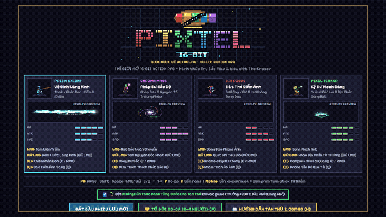
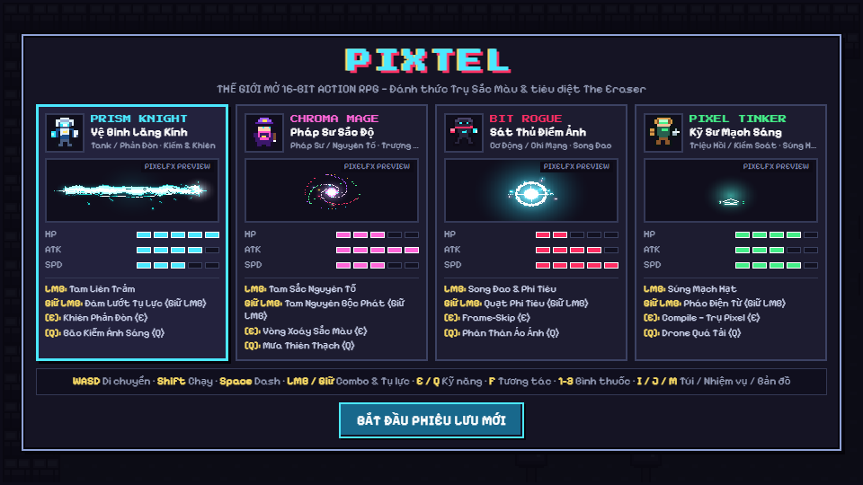
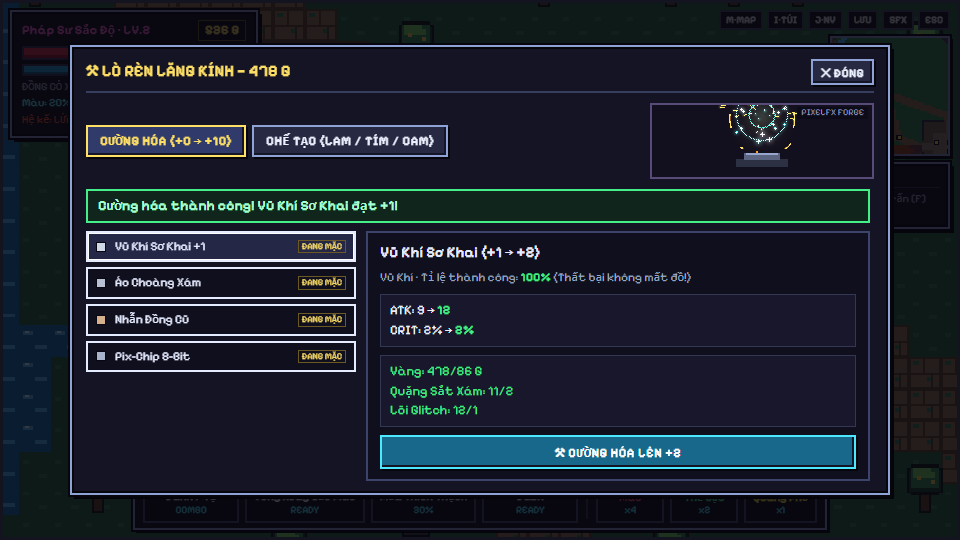

# PIXTEL

> **Thế giới mở 16-Bit Action RPG trên trình duyệt** — Chiến đấu thời gian thực, đánh thức các **Trụ Sắc Màu**, khôi phục bảng màu 16-bit cho vùng đất bị **Nhiễu Trắng** và đánh bại **The Eraser**.

[](https://www.typescriptlang.org/)
[](https://vitejs.dev/)
[](#kiến-trúc--cấu-trúc-dự-án)
[](#điểm-nổi-bật)
[](LICENSE)

---

## Video & Demo Gameplay



🎬 **[Xem / Tải Video Gameplay HD (MP4 — 18.8s, 960×540)](docs/media/gameplay-demo.mp4)**

> *Mẹo hiển thị trên GitHub:* GitHub Markdown phát tự động ảnh GIF ở trên trực tiếp trong trang repo. Nếu bạn muốn nhúng thêm trình phát video MP4 gốc của GitHub, có thể kéo-thả file `docs/media/gameplay-demo.mp4` vào trình soạn thảo README trên web GitHub để sinh link asset video.

---

## Ảnh chụp màn hình (Screenshots)

| Chọn Lớp Nhân Vật & `pixelfx` Preview | Chiến Đấu & Sóng Khôi Phục Sắc Màu |
| :---: | :---: |
|  |  |
| **4 Class với preview chiêu thức `pixelfx` trực tiếp** | **Chiêu thức nguyên tố & sóng cầu vồng đánh thức Trụ Sắc Màu** |

| Bản Đồ Thế Giới & Dịch Chuyển Nhanh `[M]` | Lò Rèn Lăng Kính (`+0 → +10` & Chế Tạo) |
| :---: | :---: |
|  |  |
| **Theo dõi % khôi phục màu & 9 Trụ Sắc Màu** | **Cường hóa an toàn không mất đồ & chế tạo trang bị** |

---

## Điểm nổi bật

- **Thế giới mở liền mạch 160×160 tile (`2560×2560px`)**: Khám phá tự do từ **Thị Trấn Khởi Nguyên** sang 4 quần xã bao quanh với địa hình, sông suối, dòng dung nham, trại quái và mỏ khoáng sản hồi sinh tự động.
- **Cơ chế Khôi Phục Sắc Màu (Color Restoration)**: Mọi vùng đất ban đầu đều bị phủ bảng màu xám xịt (**Bleached**). Khi bạn đánh thức từng **Trụ Sắc Màu** (`Chroma Waypoint`), một đợt sóng cầu vồng bùng nổ trả lại toàn bộ bảng màu 16-bit rực rỡ và mở khóa **Dịch Chuyển Nhanh `[M]`**.
- **Chiến đấu hành động 60 FPS sắc nét**: Render ở độ phân giải gốc `480×270` integer-scaled kèm vòng Thể Lực (`Stamina Wheel`), đòn đánh Combo, giữ chuột trái để **Tụ Lực**, **Dash** bất tử ngắn, kỹ năng `[E]`, tuyệt kỹ `[Q]` và phản ứng nguyên tố.
- **Hiệu ứng `pixelfx` lai hai lớp**: Kết hợp render two-buffer thời gian thực (tia laser, sóng sắc màu, vòng xoáy, mưa thiên thạch) với hệ thống atlas pool 200 slot cho đạn, vụ nổ, tia lửa rèn và cột sáng **Loot Beam** 5 phẩm chất.
- **Zero External Assets**: 100% sprite pixel 16-bit, tilemap, hiệu ứng `pixelfx` và nhạc/SFX chiptune (Web Audio API) được tổng hợp hoàn toàn bằng code, không phụ thuộc file ảnh hay âm thanh rời bên ngoài.
- **Tự động lưu tiến trình**: Lưu trữ trực tiếp vào `localStorage` (`pixtel_openworld_save_v2`) mỗi khi chuyển vùng, mở rương, kích hoạt Trụ hoặc qua nút **LƯU** / màn hình **ESC**.

---

## 4 Lớp Nhân Vật (Playable Classes)

Bạn có thể chọn Class lúc bắt đầu hoặc đổi Class ngay tại **Đài Chuyển Chức** phía Bắc quảng trường Thị Trấn Khởi Nguyên:

| Class | Tên Tiếng Việt | Vai Trò & Vũ Khí | LMB / Giữ LMB | Kỹ Năng `[E]` | Tuyệt Kỹ `[Q]` |
| :--- | :--- | :--- | :--- | :--- | :--- |
| **PRISM KNIGHT** | Vệ Binh Lăng Kính | Tank / Phản Đòn · *Kiếm & Khiên* | **Tam Liên Trảm** (combo 3 đòn) / **Đâm Lướt Tụ Lực** | **Khiên Phản Đòn** — Chặn sát thương 1.0s & bắn trả laser đa sắc | **Bão Kiếm Ánh Sáng** — Xoay kiếm giải phóng bão cầu vồng đẩy lùi diện rộng |
| **CHROMA MAGE** | Pháp Sư Sắc Độ | Pháp Sư / Nguyên Tố · *Trượng Phép* | **Tam Sắc Nguyên Tố** (Lửa–Băng–Độc kích nổ phản ứng) / **Tam Nguyên Bộc Phát** | **Vòng Xoáy Sắc Màu** — Hút quái vào tâm, gây sát thương & gắn ấn nguyên tố | **Mưa Thiên Thạch** — Triệu hồi mưa thiên thạch cầu vồng nổ pixel liên hoàn |
| **BIT ROGUE** | Sát Thủ Điểm Ảnh | Cơ Động / Chí Mạng · *Song Đao* | **Song Đao & Phi Tiêu** (tỉ lệ Crit 30%) / **Quạt Phi Tiêu** (5 phi tiêu) | **Frame-Skip** — Lướt xuyên quái bất tử ngắn, để lại tàn ảnh glitch phát nổ | **Phân Thân Ảo Ảnh** — Triệu hồi phân thân đồng bộ đòn đánh, +100% tốc đánh & +25% Crit trong 6s |
| **PIXEL TINKER** | Kỹ Sư Mạch Sáng | Triệu Hồi / Kiểm Soát · *Súng Hạt* | **Súng Mạch Hạt** (bắn trúng Trụ để hồi máu & tăng tốc bắn) / **Pháo Điện Từ** | **Compile — Trụ Pixel** — Dựng tối đa 2 trụ bắn tự động ngắm quái | **Drone Quá Tải** — Triệu hồi Drone bay quanh xả laser & hồi HP cho bản thân + trụ |

---

## Thế Giới Mở, 4 Quần Xã & Boss

| Khu Vực | Vị Trí | Cấp Độ | Trụ Sắc Màu | Quái Vật & Boss |
| :--- | :---: | :---: | :---: | :--- |
| **Thị Trấn Khởi Nguyên** | Trung tâm | `SAFE` | 1 Trụ *(mở sẵn)* | 3 NPC (`Trưởng Làng Elian`, `Thợ Rèn Kael`, `Thương Nhân Mira`) & Đài Chuyển Chức |
| **Đồng Cỏ Xám** (*Ash Meadow*) | Tây Bắc | `LV 1–5` | 2 Trụ | Slime Nhiễu, Bọ Xám Phóng, Tiểu Quỷ Tĩnh Điện |
| **Rừng Thạch Anh** (*Quartz Forest*) | Đông Bắc | `LV 5–10` | 2 Trụ | Tiểu Quỷ Tĩnh Điện, Sói Trắng Xám, Vệ Binh Thạch Anh · **Boss: `BLIGHT ROOT`** (`980 HP`) |
| **Hầm Mỏ Hổ Phách** (*Amber Mines*) | Tây Nam | `LV 10–15` | 2 Trụ | Bọ Giáp Hổ Phách, Quỷ Than Nham, Khổng Lồ Lăng Kính · **Boss: `GILDED NULL`** (`1580 HP`) |
| **Phế Tích Vô Sắc** (*Blank Ruins*) | Đông Nam | `LV 15–20` | 2 Trụ | Khổng Lồ Lăng Kính, Oan Hồn Vô Sắc · **World Boss: `THE ERASER`** (`2600 HP`) |

Ngoài ra trên bản đồ còn có **12 Trại Quái** (diệt sạch quái để giải phong ấn Rương Kho Báu) và **20 Mỏ Khoáng Sản / Tinh Thể** (`Quặng Sắt Xám`, `Mảnh Thạch Anh`, `Mảnh Hổ Phách`, `Lăng Kính Hư Vô`) tự hồi sinh sau ~26–38 giây.

---

## Hệ Thống Trang Bị, Lò Rèn & Nhiệm Vụ

- **4 Ô Trang Bị & 20 Món Đồ**: `Vũ Khí`, `Áo Giáp`, `Nhẫn`, `Pix-Chip` trải dài 5 phẩm chất (**Thường** · **Hiếm Nhẹ** · **Quý Hiếm** · **Sử Thi** · **Huyền Thoại**) kèm cột sáng **Loot Beam** khi rơi ra đất và bảng so sánh chỉ số xanh/đỏ trong Túi Đồ (`32 ô`).
- **Lò Rèn Lăng Kính (Thợ Rèn Kael)**:
  - **Cường hóa `+0 → +10`**: An toàn tuyệt đối (thất bại không mất hay vỡ trang bị); 100% thành công tới `+4`; vũ khí đạt `+5` và `+8` mở khóa hào quang dưới chân nhân vật.
  - **Chế tạo (9 công thức)**: Đúc trang bị phẩm **Lam**, **Tím** và thần khí **Huyền Thoại (Cam)** (`Thần Khí Thất Sắc`, `Thánh Giáp Lăng Kính`, `Pix-Chip Alpha-Chroma`).
- **3 Bình Thuốc Phím Tắt**: `[1]` *Bình Máu Sắc Độ* (+45% HP), `[2]` *Tinh Chất Thể Lực* (đầy Stamina + 28% SPD), `[3]` *Dược Phẩm Quang Phổ* (+30% ATK & +15% Crit).
- **10 Nhiệm Vụ**: Chuỗi **8 nhiệm vụ cốt truyện** từ *Khởi Đầu Thanh Tẩy* đến *Xóa Sổ Nhiễu Trắng* (`The Eraser`), cộng **2 nhiệm vụ Truy Nã lặp lại** (*Diệt Glitchborn*, *Thợ Mỏ Tinh Thể*) để cày Vàng và nguyên liệu.

---

## Điều Khiển (Controls)

| Phím / Chuột | Chức Năng |
| :--- | :--- |
| `W` `A` `S` `D` hoặc Phím mũi tên | Di chuyển nhân vật |
| `Shift` | Chạy nhanh (tiêu hao Thể Lực) |
| `Space` | Dash lướt nhanh né đòn (bất tử ngắn) |
| `Chuột Trái (LMB)` | Đánh thường / Combo |
| `Giữ Chuột Trái (LMB)` | Tụ lực tung đòn **Charged Attack** |
| `E` hoặc `Chuột Phải (RMB)` | Dùng Kỹ năng đặc trưng của Class |
| `Q` | Kích hoạt Tuyệt kỹ (khi đạt `100% Overdrive`) |
| `F` | Tương tác (NPC, Đài Chuyển Chức, Trụ Sắc Màu, mở Rương, nhặt đồ) |
| `1` / `2` / `3` | Sử dụng Bình Máu / Tinh Chất Thể Lực / Dược Phẩm Quang Phổ |
| `I` | Mở / Đóng **Túi Đồ & Trang Bị** |
| `J` | Mở / Đóng **Sổ Nhiệm Vụ** |
| `M` | Mở / Đóng **Bản Đồ Thế Giới & Dịch Chuyển Nhanh** |
| `ESC` | Tạm dừng / Lưu nhanh / Về màn hình chính |

---

## Cài Đặt & Chạy Local

### Yêu cầu
- [Node.js](https://nodejs.org/) **v18+** (khuyến nghị v20+) và `npm`.

### Các lệnh phát triển

```bash
# 1. Clone repository
git clone https://github.com/TrungLegit/PixTel.git
cd PixTel

# 2. Cài đặt dependencies
npm install

# 3. Chạy dev server (hot-reload)
npm run dev
```

Các script khác trong `package.json`:

```bash
npm run typecheck   # Kiểm tra kiểu TypeScript (tsc --noEmit)
npm run build       # Build bản production ra thư mục dist/
npm run preview     # Xem trước bản build production tại local
```

---

## Kiến Trúc & Cấu Trúc Dự Án

```text
PixTel/
├── index.html                  # Shell HTML, HUD & 7 modal giao diện pixel
├── style.css                   # Theme 16-bit, Pixelify Sans & responsive integer canvas
├── docs/
│   └── media/                  # Video MP4, GIF demo và 4 ảnh chụp màn hình gameplay
└── src/
    ├── main.ts                 # Điểm khởi chạy, kết nối Game Engine với các UI modal
    ├── game.ts                 # Vòng lặp 60FPS (480×270), camera culling, Y-sort, stamina & input
    ├── audio/
    │   └── chiptuneSynth.ts    # Bộ tổng hợp SFX 8-bit/16-bit bằng Web Audio API
    ├── data/
    │   ├── classes.ts          # Cấu hình 4 Class & chiêu thức
    │   ├── enemies.ts          # 9 loại quái thường + 3 Boss (Blight Root, Gilded Null, The Eraser)
    │   ├── items.ts            # 20 trang bị 5 phẩm chất, 5 nguyên liệu, 3 bình thuốc & scaling +0..+10
    │   ├── quests.ts           # 8 nhiệm vụ cốt truyện + 2 Truy Nã lặp lại
    │   ├── recipes.ts          # 9 công thức chế tạo tại Lò Rèn Lăng Kính
    │   ├── types.ts            # Định nghĩa TypeScript interfaces & SaveDataV2
    │   └── worldConfig.ts      # Bản đồ 160×160, bảng màu Bleached/Restored, NPC, 9 Trụ, 12 Trại, 20 Mỏ
    ├── graphics/
    │   ├── colorRestoration.ts # Tính toán vùng đã khôi phục màu & hiệu ứng sóng lan tỏa
    │   ├── pixelSprites.ts     # Atlas sprite 16-bit sinh bằng code (Hero, NPC, Quái, Boss, Tileset)
    │   └── tileRenderer.ts     # Render map 2560×2560 tối ưu theo viewport & minimap tổng quan
    ├── systems/
    │   ├── combat.ts           # Hệ thống chiến đấu 4 Class, AI tuần tra/aggro/leash & 3 Boss AI
    │   ├── forgeSystem.ts      # Logic cường hóa +0..+10 & chế tạo trang bị
    │   ├── inventorySystem.ts  # Quản lý Vàng, 4 ô trang bị, túi 32 ô & so sánh chỉ số
    │   ├── questSystem.ts      # Theo dõi tiến độ nhiệm vụ & dấu !/? trên NPC
    │   └── saveSystem.ts       # Đọc/ghi SaveDataV2 trên localStorage
    ├── ui/
    │   ├── ClassSelect.ts      # Màn hình chọn Class / Continue Save / Đài Chuyển Chức
    │   ├── DialogueModal.ts    # Hội thoại NPC, nhận/trả nhiệm vụ & cửa hàng Mira
    │   ├── ForgeModal.ts       # Giao diện Lò Rèn với canvas tia lửa pixelfx trực tiếp
    │   ├── HUD.ts              # Thanh HP/XP, Minimap, Quest Tracker, Hotbar & Toast
    │   ├── InventoryModal.ts   # Giao diện Túi Đồ & so sánh chỉ số
    │   ├── QuestJournalModal.ts# Sổ Nhiệm Vụ [J]
    │   └── WorldMapModal.ts    # Bản đồ thế giới [M] & Dịch Chuyển Nhanh
    ├── vfx/
    │   ├── fxAtlas.ts          # Pre-bake sprite sheet pixelfx cho đạn, nổ & loot beam
    │   ├── pixelfx/            # Engine pixelfx core & các effect tùy biến trong fx/pixtel/
    │   ├── pixelfxTypes.ts     # Typing cho pixelfx
    │   └── vfxManager.ts       # Object pooling & viewport culling (26 live slots + 200 atlas slots)
    └── world/
        ├── entities.ts         # Entity runtime (Player, Enemy, Projectile, Turret, Hazard)
        ├── interactables.ts    # Tìm mục tiêu tương tác gần nhất cho phím [F]
        ├── spawner.ts          # Quản lý hồi sinh trại quái, rương khóa & mỏ khoáng sản
        └── worldMap.ts         # Sinh thế giới mở 160×160 & kiểm tra va chạm tile
```

---

## Giấy Phép (License)

Dự án được phát hành theo giấy phép **MIT** — xem chi tiết tại [LICENSE](LICENSE).
