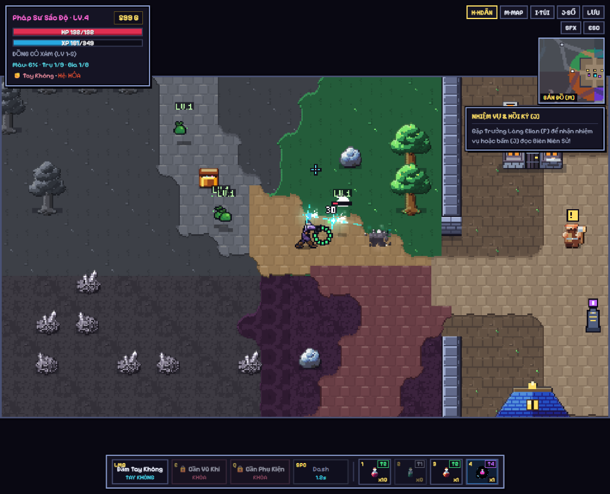
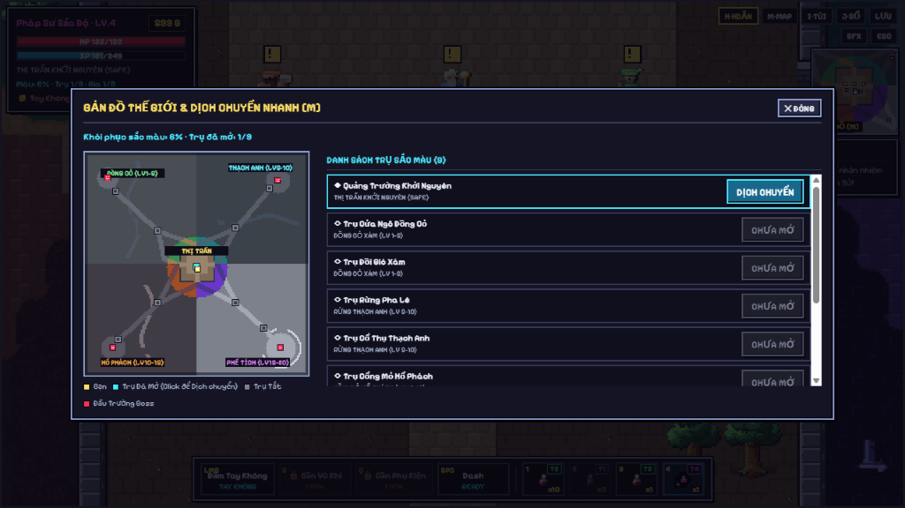
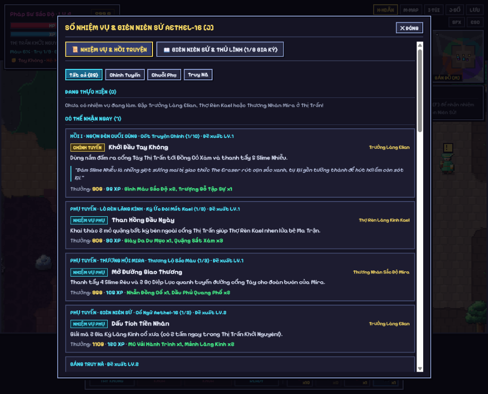

# PIXTEL

> **Thế giới mở 16-Bit Action RPG trên trình duyệt (PC · Mobile PWA · Co-op 2–4 Người)** — Khởi đầu tay không tại **Thị Trấn Khởi Nguyên**, săn trang bị **khóa chặt theo Class**, luyện **Ma Trận Luyện Khí**, kích nổ **9 Nguyên Tố**, rủ tổ đội thắp **9 Trụ Sắc Màu** và thanh tẩy **World Boss THE ERASER**.

### 🎮 **[CHƠI NGAY TRÊN GITHUB PAGES → `https://trunglegit.github.io/PixTel/`](https://trunglegit.github.io/PixTel/)**

[](https://trunglegit.github.io/PixTel/)
[](https://www.typescriptlang.org/)
[](https://vitejs.dev/)
[](#kiến-trúc--cấu-trúc-dự-án)
[](public/licenses/Pixelify-Sans-OFL.txt)
[](LICENSE)

---

## 🌐 Chơi Ngay Trên Điện Thoại & Trình Duyệt (Không Cần Cài Đặt!)

👉 **Link Chơi Online Chính Thức (PC · Android · iPhone/iPad):** **[https://trunglegit.github.io/PixTel/](https://trunglegit.github.io/PixTel/)**

- **📱 Mobile Twin-Stick + Smart Auto-Aim + PWA Fullscreen**:
  - Tự động nhận diện màn hình cảm ứng (hoặc bấm nút `📱` trên thanh công cụ HUD) để bật **Joystick Analog trái** (đẩy ra viền ngoài tự động **Chạy Nhanh** kèm nút khóa Sprint) + **Cụm phím chiến đấu đa điểm phải** (`⚔ ĐÁNH / TỤ` phát sáng vàng ở khung *Just-Charge*, `💨 LƯỚT`, `✦ [E]`, `🔥 [Q]`, `🖐 [F]`).
  - Hỗ trợ **Tự Ngắm Mục Tiêu Thông Minh (Smart Auto-Aim)** ưu tiên Trụ Đấu Trường → Boss/Quái → Mỏ quặng, hoặc kéo tay trực tiếp từ nút đánh để **ngắm thủ công 360°**; chạm vào vật phẩm để xem chi tiết (*Tap-to-Inspect*).
  - **Cài đặt như App ngang Fullscreen (`PWA`)**: Trên Android bấm **Cài đặt ứng dụng / Thêm vào MH chính**; trên iOS Safari bấm **Chia sẻ ➔ Thêm vào MH chính**.
- **🤝 Tổ Đội Co-op Online 2–4 Người (`[P]` / Mã Phòng 6 Ký Tự)**:
  - **Chế độ WebRTC P2P (`PeerJS`)**: Chạy trực tiếp trên link GitHub Pages & mạng 4G/Wi-Fi điện thoại mà không cần mở port hay chạy server riêng. Bấm **`P·COOP`** (`[P]`) ➔ **Tạo Phòng** lấy **Mã 6 Ký Tự** hoặc bấm chia sẻ **Link Mời `?room=CODE`** 1 chạm gửi qua Zalo/Messenger/Discord!
  - **Chế độ Dedicated WebSocket Server (`npm run server`)**: Máy chủ phòng Node.js (`ws://0.0.0.0:8787`) hỗ trợ nhiều phòng độ trễ thấp khi tự host.
  - Phối hợp **Phản Ứng Nguyên Tố Kép 9 Hệ** chéo giữa các thành viên, chia sẻ thắp **Trụ Sắc Màu**, ưu tiên kéo aggro cho khiên **Prism Knight**, **Dịch Chuyển nhanh tới đồng đội** ngay trên khung Tổ Đội HUD và nhận **100% XP + Vật phẩm rơi riêng (Instanced Loot)** cho từng người.

---

## Video & Demo Gameplay


🎬 **[Xem / Tải Video Gameplay HD (MP4 — 18.8s, 960×540)](docs/media/gameplay-demo.mp4)** · 🌐 **[Chơi bản Live Web ngay](https://trunglegit.github.io/PixTel/)**

---

## Giao diện hiện tại (PIXTEL v2.7)

| Màn hình Chọn Class (`PIXTEL 16-BIT` & `pixelfx`) | Chiến Đấu Thế Giới Mở & HUD v2.7 |
| :---: | :---: |
|  |  |
| **4 Class model 3D `pixelfx`, preview chiêu & hỗ trợ link mời `?room=CODE`** | **Ranh giới Bleached / Restored, 122-frame quái, nút `P·COOP` · `📱` · `⛶` & 4 ô thuốc** |

| Túi Đồ 40 Ô, 5 Ô Trang Bị & Điểm Tiềm Năng `[I/B]` | Ma Trận Luyện Khí (`+0 → +10`) & Thẻ Phẩm Chất |
| :---: | :---: |
|  |  |
| **Preview Hero 3D, `STR/VIT/AGI/CRT`, Trang Bị Tốt Nhất & khóa Class (`✕`)** | **Cường hóa ma trận, thức tỉnh dòng phụ, 8 Sắc Tố `+5` & 8 Cổ Vật Ẩn** |

| Bản Đồ Thế Giới & Dịch Chuyển Nhanh `[M]` | Sổ Nhiệm Vụ (25 Quest) & Biên Niên Sử `[J]` |
| :---: | :---: |
|  |  |
| **Theo dõi % khôi phục sắc màu, 9 Trụ Sắc Màu & 4 Đấu Trường Boss** | **10 Nhiệm vụ Chính, 12 Chuỗi Phụ & 3 Truy Nã + 8 Bia Ký Lore** |

---

## Điểm nổi bật (`v2.7`)

- **Hardcore Progression & Khóa Vũ Khí Nghiêm Ngặt Theo Class**: Nhân vật bắt đầu hoàn toàn **tay không** (`Đấm Tay Không` ở LMB; kỹ năng `[E]` khóa tới khi cầm **vũ khí đúng Class** và Tuyệt Kỹ `[Q]` mở khi đeo Phụ Kiện). **0% vũ khí dùng chung (`all`)**: Kiếm/Kích/Phủ/Chùy thuộc `Vệ Binh Lăng Kính`, Trượng thuộc `Pháp Sư Sắc Độ`, Song Đao/Lưỡi Hái thuộc `Sát Thủ Điểm Ảnh`, Súng/Pháo thuộc `Kỹ Sư Mạch Sáng`. Save cũ có vũ khí lệch Class tự động tháo về túi khi tải game; Cửa hàng Mira hiển thị nhãn `Hệ: <Class>` xanh/đỏ và Túi đồ đánh dấu `✕` đỏ rõ ràng.
- **Ma Trận Phản Ứng 9 Nguyên Tố**: Đầy đủ **9 nguyên tố** (`Hỏa`, `Băng`, `Mộc`, `Lôi`, `Gió`, `Chấn Động`, `Hư Không`, `Sắc Độ`, `Lăng Kính`) với **28 phản ứng theo cặp Primer + Detonator** cộng **Khúc Xạ Cầu Vồng 3 tia tự tìm mục tiêu** (`Prism` — tổng **29 phản ứng**), hỗ trợ kích nổ chéo giữa các đồng đội Co-op.
- **Đồ Họa 16-Bit `pixelfx` & Atlas Quái 122 Frame**:
  - 4 Class dựng bằng mô hình khớp 3D `pixelfx` (`poseAt` đồng bộ 12fps theo từng góc đánh & Paper-Doll 5 món trực tiếp trên người, đồng bộ sang máy đồng đội Co-op).
  - 10 quái & Boss tại Đồng Cỏ / Thạch Anh dùng atlas 4 hướng **122 frame** (vỗ cánh, nhún thạch, mắt nheo đập đất, cuộn tròn xoay mai, bóng đổ co giãn theo độ cao) cùng chuỗi VFX riêng như `sonic-wave`, `leaf-storm`, `rainbow-burst`, `hex-shield`.
- **Thế Giới Mở Liền Mạch & Phong Ấn Boss**: Bản đồ `160×160` tile (`480×270` integer-scaled) với địa hình **Dual-Grid**, cơ chế khôi phục màu từ vùng **Bleached** khi đánh thức **9 Trụ Sắc Màu**, **4 Đấu Trường Boss khóa địa giới** chống hit-and-run và World Boss **THE ERASER** 3 giai đoạn kèm Trụ Totem Nguyên Sinh.
- **8 Cổ Vật Ẩn (`Hidden Relics`) & Ma Trận Luyện Đồ**: 4 bản vẽ `craft_only` + 4 cổ vật `boss_only` (rơi 100% ở lần đầu hạ Boss, che danh tính `???` trước khi giải mã), cường hóa **Ma Trận Luyện Khí `+0 → +10`** có bảo hiểm Pity + khảm 8 Bột Sắc Tố.
- **Font Pixel Tiếng Việt Offline & Cẩm Nang 5 Tab `[H]`**: Tự lưu trữ `Pixelify Sans Variable` nội bộ (`@fontsource-variable/pixelify-sans`), không phụ thuộc CDN ngoài, tự động lưu vào `localStorage`.

---

## 4 Lớp Nhân Vật (Playable Classes)

Chọn Class ở màn hình đầu hoặc đổi tại **Đài Chuyển Chức** phía Bắc quảng trường Thị Trấn Khởi Nguyên (trang bị lệch Class sẽ tự tháo an toàn về túi đồ):

| Class | Tên Tiếng Việt | Vũ Khí Độc Quyền | Đánh Thường (`LMB`) / Vận Sức (`Giữ LMB`) | Kỹ Năng `[E / RMB]` | Tuyệt Kỹ `[Q]` |
| :--- | :--- | :--- | :--- | :--- | :--- |
| **PRISM KNIGHT** | Vệ Binh Lăng Kính | *Kiếm / Kích / Phủ / Chùy* | **Tam Liên Trảm** (N3 gắn `[Quake]`) / **Đâm Lướt Lăng Kính** | **Khiên Phản Đòn** — Chặn, hút aggro Co-op & bắn tia Lăng Kính | **Bão Kiếm Ánh Sáng** — Xoay kiếm bão cầu vồng phá giáp |
| **CHROMA MAGE** | Pháp Sư Sắc Độ | *Trượng / Quyền Trượng* | **Ngũ Sắc Luân Chuyển** (5 hệ) / **Tam Nguyên Bộc Phát** (3 cầu) | **Xoáy Hư Sắc** — Gom quái, xóa buff & nổ liên hoàn | **Mưa Thiên Thạch Thất Sắc** — Giáng 6 thiên thạch cầu vồng |
| **BIT ROGUE** | Sát Thủ Điểm Ảnh | *Song Đao / Lưỡi Hái* | **Song Đao Phong Ảnh** (cận chiến thuần túy, N3 lốc Gió 360°) / **Quạt 5 Phi Tiêu** | **Frame-Skip Hư Không** — Lướt bất tử để lại tàn ảnh nổ Void | **Phân Thân Ảo Ảnh** — Chém song hành, `+100%` tốc đánh & `+25%` Crit |
| **PIXEL TINKER** | Kỹ Sư Mạch Sáng | *Súng Hạt / Pháo Hạt* | **Súng Mạch Hạt** (hồi máu & Overclock Trụ) / **Pháo Địa Chấn** (`[Quake]`) | **Compile — Trụ Lôi Quang** — Dựng tối đa 2 Trụ tự bắn | **Drone Sắc Độ Quá Tải** — Drone xả laser & hồi HP/Thể lực |

---

## Thế Giới Mở, 4 Quần Xã & Hệ Thống Boss

| Khu Vực | Vị Trí | Cấp Độ | Trụ Sắc Màu | Quái Vật, Boss Phụ & Boss Chính |
| :--- | :---: | :---: | :---: | :--- |
| **Thị Trấn Khởi Nguyên** | Trung tâm | `SAFE` | 1 Trụ *(mở sẵn)* | 3 NPC (`Trưởng Làng Elian`, `Thợ Rèn Kael`, `Thương Nhân Mira`), Đài Chuyển Chức & 2 Bia Ký |
| **Đồng Cỏ Xám** (*Meadow*) | Tây Bắc | `LV 1–5` | 2 Trụ | `Slime Rêu`, `Bọ Diệp Lục`, `Xạ Thủ Gai`, Boss Phụ `Golem Rễ Cây` · **Boss: `HỘ VỆ CỔ THỤ — XING WARDEN`** (`1250 HP`) |
| **Rừng Thạch Anh** (*Quartz*) | Đông Bắc | `LV 5–10` | 2 Trụ | `Lăng Kính Trôi`, `Dơi Pha Lê`, `Cua Thạch Anh`, Boss Phụ `Kỵ Sĩ Thạch Anh` · **Boss: `RỒNG LĂNG KÍNH — BLIGHT PRISM`** (`2350 HP`) |
| **Hầm Mỏ Hổ Phách** (*Amber*) | Tây Nam | `LV 10–15` | 2 Trụ | `Bọ Giáp Hổ Phách`, `Quỷ Than Nham` · **Boss: `GILDED NULL — CÙNG KỲ HỔ PHÁCH`** (`4100 HP`) |
| **Phế Tích Vô Sắc** (*Ruins*) | Đông Nam | `LV 15–20` | 2 Trụ | `Khổng Lồ Lăng Kính`, `Oan Hồn Vô Sắc` · **World Boss: `THE ERASER — THỰC THỂ XÓA SẮC`** (`6800 HP`, 3 Phase) |

Ngoài ra bản đồ còn có **12 Trại Quái** (diệt sạch mở khóa Rương Kho Báu), **20 Mỏ Khoáng Sản / Tinh Thể** tự hồi sinh và **8 Bia Ký Lịch Sử Aethel-16**.

---

## Hệ Thống Trang Bị, Luyện Đồ & 25 Nhiệm Vụ

- **Trang Bị 5 Ô & Túi Đồ 40 Ô**: `Mũ`, `Áo Giáp`, `Vũ Khí` *(khóa Class)*, `Giày`, `Phụ Kiện` trải dài 5 phẩm chất (**Thường** · **Hiếm Nhẹ** · **Quý Hiếm** · **Sử Thi** · **Huyền Thoại**), kèm **Loot Beam**, nút **⚡ Trang Bị Tốt Nhất**, **💰 Bán Nhanh** (tự đánh dấu đồ lệch Class & cho phép tích chọn thêm) và phân bổ **Điểm Tiềm Năng** (`STR / VIT / AGI / CRT`).
- **Ma Trận Luyện Khí & Chế Tạo (Thợ Rèn Kael)**:
  - **Cường hóa `+0 → +10`**: Tụ linh ma trận để thức tỉnh dòng phụ ngẫu nhiên tại `+1`, bảo hiểm **Pity** khi trượt, mở khóa **Khe Khảm 8 Sắc Tố** tại `+5` và **Thức Tỉnh Lăng Kính** tại `+10`.
  - **Chế tạo & 8 Cổ Vật Ẩn**: Hơn 30 bản vẽ đúc đồ Lam/Tím/Cam cùng **8 Cổ Vật Ẩn** (`4 craft_only` + 4 `boss_only`) sở hữu 3 nội tại độc quyền (`restored_prism_surge`, `energy_siphon_magnet`, `set_resonance_echo`).
- **4 Nhóm Thuốc Thông Minh `[1]..[4]`**: Máu `[1]`, Thể Lực `[2]`, Sức Mạnh `[3]`, Hộ Thuẫn / Dầu Phủ Quang Phổ `[4]`.
- **25 Nhiệm Vụ**: **10 Nhiệm Vụ Chính Tuyến** (`Hồi I–V`), **12 Nhiệm Vụ Phụ theo chuỗi 3 bước** (*Kael*, *Mira*, *Elian*, *Biệt Đội Đột Kích*) và **3 Bảng Truy Nã** lặp lại.

---

## Điều Khiển (PC & Mobile Touch)

| PC (`Bàn Phím & Chuột`) | Mobile / Tablet (`Twin-Stick Touch`) | Chức Năng |
| :--- | :--- | :--- |
| `W` `A` `S` `D` / Mũi tên | **Joystick Analog Trái** | Di chuyển nhân vật |
| `Shift` | Đẩy Joystick sát viền (`≥ 82%`) / Nút khóa **Sprint** | Chạy nhanh (tiêu hao Thể Lực) |
| `Space` | Nút **`💨 LƯỚT`** | Dash lướt nhanh né đòn (`Chroma Dodge` đầu pha lướt) |
| `Chuột Trái (LMB)` | Chạm nút **`⚔ ĐÁNH / TỤ`** | Đánh thường 3 nhịp (*hoặc Đấm Tay Không khi chưa cầm vũ khí*) |
| `Giữ LMB` | Giữ nút **`⚔ ĐÁNH / TỤ`** *(kéo ngắm 360°)* | Vận sức **Charged Attack** (`Just-Charge` khi thả đúng nhịp vàng) |
| `E` hoặc `Chuột Phải (RMB)` | Nút **`✦ [E]`** | Dùng Kỹ năng đặc trưng Class *(yêu cầu cầm vũ khí đúng Class)* |
| `Q` | Nút **`🔥 [Q]`** | Kích hoạt Tuyệt Kỹ *(yêu cầu đeo Phụ Kiện & đủ `100% Overdrive`)* |
| `F` | Nút **`🖐 [F]`** | Tương tác (NPC, Đài Chuyển Chức, Trụ Sắc Màu, Bia Ký, Rương, Nhặt đồ) |
| `1` `2` `3` `4` | Chạm thanh Hotbar dưới đáy | Dùng nhanh bình thuốc Máu / Thể Lực / Công Kích / Hộ Thuẫn & Dầu Phủ |
| `P` | Nút **`P·COOP`** trên HUD | Mở phòng **Tổ Đội Co-op Online 2–4 Người** (WebRTC P2P / WebSocket) |
| `I` hoặc `B` | Nút **`I·TÚI`** | Mở / Đóng **Túi Đồ, Trang Bị & Điểm Tiềm Năng** |
| `J` | Nút **`J·SỔ`** | Mở / Đóng **Sổ Nhiệm Vụ & Biên Niên Sử Aethel-16** |
| `M` | Nút **`M·MAP`** / Minimap | Mở / Đóng **Bản Đồ Thế Giới & Dịch Chuyển Nhanh** |
| `H` hoặc `F1` | Nút **`H·HDẪN`** | Mở **Cẩm Nang Tân Thủ & Bảng 29 Phản Ứng 9 Nguyên Tố** |
| `ESC` | Nút **`ESC`** · **`📱`** · **`⛶`** | Tạm dừng / Bật-tắt nút cảm ứng / Toàn màn hình ngang |

---

## Chơi Online (GitHub Pages) & Cài Đặt Local

### 1. Chơi trực tiếp trên GitHub Pages
- Truy cập: **[https://trunglegit.github.io/PixTel/](https://trunglegit.github.io/PixTel/)**
- Repo đã tích hợp sẵn workflow tự động chạy test (`npm test`), build Vite + PWA (`npm run build`) và deploy `./dist` lên GitHub Pages tại [.github/workflows/deploy-pages.yml](.github/workflows/deploy-pages.yml) mỗi khi push lên `main` *(lần đầu trên GitHub Repo chỉ cần bật `Settings → Pages → Source: GitHub Actions`)*.

### 2. Chạy & kiểm thử ở máy Local

- Yêu cầu **Node.js v18+** (khuyến nghị v22+) và `npm`.

```bash
# 1. Clone repository
git clone https://github.com/TrungLegit/PixTel.git
cd PixTel

# 2. Cài đặt dependencies (Pixelify Sans Offline, PeerJS, ws, Vite, TypeScript...)
npm install

# 3. Chạy dev server (http://127.0.0.1:5173/)
npm run dev
```

Các lệnh kiểm tra, Co-op server & đóng gói khác trong `package.json`:

```bash
npm test            # Chạy toàn bộ 13 bộ kiểm thử tự động (Combat, Class Locks, 9 Elements, Hidden Relics, Mobile & Co-op)
npm run server      # Chạy Dedicated WebSocket Co-op Room Server tại ws://0.0.0.0:8787
npm run typecheck   # Kiểm tra kiểu TypeScript (tsc --noEmit)
npm run build       # Build bản production + PWA ra thư mục dist/
npm run preview     # Xem trước bản build production tại local
```

---

## Kiến Trúc & Cấu Trúc Dự Án

```text
PixTel/
├── .github/workflows/
│   └── deploy-pages.yml         # CI/CD tự động chạy npm test, build & deploy lên GitHub Pages
├── index.html                   # Shell HTML, HUD, Co-op/Mobile layers & các modal giao diện 16-bit
├── style.css                    # Theme Pixelify Sans offline, responsive integer canvas & Mobile HUD
├── public/
│   ├── manifest.webmanifest     # Cấu hình PWA cài đặt fullscreen ngang trên Android / iOS
│   ├── sw.js                    # Service Worker cache tài nguyên PWA
│   ├── icon.svg                 # Biểu tượng app PixTel PWA
│   └── licenses/
│       └── Pixelify-Sans-OFL.txt
├── server/
│   └── coopServer.ts            # Dedicated WebSocket Co-op Room Server (npm run server, port 8787)
├── docs/media/                  # Video MP4, GIF demo & 6 ảnh màn hình PIXTEL v2.7
├── scripts/
│   └── extract_enemy_sprites.py # Pipeline trích & sinh atlas quái 4 hướng 122 frame
├── tests/
│   └── featureTests.ts          # 13 bộ kiểm thử tự động (9 Elements, Class Locks, Hidden Relics, Mobile & Co-op)
└── src/
    ├── main.ts                  # Khởi chạy font offline, Canvas, Mobile/Co-op modal & Service Worker
    ├── game.ts                  # Vòng lặp 60FPS (480×270), Auto-Aim, đồng bộ Co-op, Dual-Grid & Input
    ├── net/
    │   ├── protocol.ts          # Giao thức Co-op (mã phòng 6 ký tự, trạng thái đồng đội, hit/loot/reaction)
    │   └── coopClient.ts        # Dual transport client: WebRTC P2P (PeerJS) + WebSocket Server
    ├── assets/                  # Sprite atlases PNG/JSON (Hero Paper-Doll, Icons, 122-frame Enemies)
    ├── audio/
    │   └── chiptuneSynth.ts     # Bộ tổng hợp SFX 8-bit/16-bit bằng Web Audio API
    ├── data/
    │   ├── classes.ts           # Cấu hình 4 Class & bộ chiêu thức
    │   ├── elements.ts          # 9 Nguyên Tố & Ma trận 28 phản ứng theo cặp + Khúc Xạ Cầu Vồng
    │   ├── enemies.ts           # 12 loại quái/boss phụ + 4 Boss (Xing Warden, Blight Prism, Gilded Null, The Eraser)
    │   ├── equipments.ts        # Trang bị 5 ô khóa theo Class & bộ chỉ số Set Bonus
    │   ├── hiddenItems.ts       # 8 Cổ Vật Ẩn (4 craft_only + 4 boss_only) & nội tại đặc biệt
    │   ├── items.ts             # Kho đồ, khóa vũ khí Class, Shop Mira & scaling +0..+10
    │   ├── lootTables.ts        # Tỷ lệ rơi đồ quái & Boss
    │   ├── lore.ts              # Biên niên sử Aethel-16 & 8 Bia Ký
    │   ├── quests.ts            # 25 Nhiệm vụ (10 Chính, 12 Chuỗi Phụ, 3 Truy Nã)
    │   ├── recipes.ts           # 33 công thức chế tạo + Bản Vẽ Ẩn
    │   ├── types.ts             # Định nghĩa TypeScript interfaces & SaveDataV2
    │   └── worldConfig.ts       # Bản đồ 160×160, 4 Quần Xã, 9 Trụ, 12 Trại, 20 Mỏ & Boss Arenas
    ├── graphics/
    │   ├── colorRestoration.ts  # Vùng khôi phục màu & sóng cầu vồng
    │   ├── enemyAtlas.ts        # Renderer 4 hướng 122-frame cho 10 quái/boss + bóng đổ động
    │   ├── itemIcons.ts         # Icon trang bị & nguyên liệu 5 tầng phẩm chất
    │   ├── paperDoll.ts         # Paper-Doll trang bị mặc trực tiếp lên nhân vật (Local + Co-op Peers)
    │   ├── pixelSprites.ts      # Atlas sprite 16-bit & NPC/Boss dự phòng
    │   ├── pixelfxHeroModels.ts # Rig 3D pixelfx cho 4 Class đồng bộ pose 12fps
    │   └── tileRenderer.ts      # Dual-Grid tilemap renderer & minimap
    ├── systems/
    │   ├── combat.ts            # Combat 4 Class, khóa vũ khí Class, AI quái, Boss Phase 1–3 & Co-op hooks
    │   ├── forgeSystem.ts       # Ma Trận Luyện Khí (+0..+10), 8 Bột Sắc Tố & Chế Tạo
    │   ├── inventorySystem.ts   # Túi 40 ô, 5 ô trang bị, Equip Best, Bán Nhanh & khóa Class
    │   ├── questSystem.ts       # Theo dõi 25 nhiệm vụ & phần thưởng theo Class
    │   └── saveSystem.ts        # Đọc/ghi SaveDataV2 & mở khóa Cổ Vật Ẩn qua localStorage
    ├── ui/
    │   ├── ClassSelect.ts       # Màn hình PIXTEL 16-BIT pixel-grid, 4 Class preview & `?room=CODE`
    │   ├── CoopModal.ts         # Phòng Co-op Online 2–4 Người [P] (WebRTC P2P / Dedicated WS)
    │   ├── DialogueModal.ts     # Hội thoại NPC, nhiệm vụ & Cửa hàng Mira (nhãn Hệ Class)
    │   ├── ForgeModal.ts        # Ma Trận Luyện Khí & Tab ✦ Bản Vẽ Ẩn
    │   ├── HUD.ts               # Thanh HP/XP, Tổ Đội Co-op, Minimap, Quest Tracker & Hotbar
    │   ├── InventoryModal.ts    # Túi đồ, Preview Hero 3D, Tiềm Năng & Bán Nhanh
    │   ├── ItemReviewTooltip.ts # Khung xem trước trang bị 5 tầng phẩm chất, Tap-to-Inspect & che ??? đồ ẩn
    │   ├── MobileTouchUI.ts     # Điều khiển Twin-Stick Joystick trái & cụm nút chiến đấu đa điểm phải
    │   ├── QuestJournalModal.ts # Sổ Nhiệm Vụ [J] & Bia Ký Aethel-16
    │   ├── TutorialModal.ts     # Cẩm Nang Tân Thủ 5 Tab & Ma trận Nguyên Tố [H]
    │   └── WorldMapModal.ts     # Bản đồ thế giới [M] & Dịch Chuyển Nhanh
    ├── vfx/
    │   ├── fxAtlas.ts           # Pre-bake atlas pool cho đạn, nổ & loot beam
    │   ├── pixelfx/             # Engine pixelfx core & custom VFX (sonic-wave, leaf-storm, rainbow-burst, hex-shield...)
    │   ├── pixelfxTypes.ts      # Typing cho pixelfx
    │   └── vfxManager.ts        # Object pooling & viewport culling
    └── world/                   # Entities, Interactables, Spawner & WorldMap 160×160
```

---

## Giấy Phép (License)

Dự án được phát hành theo giấy phép **MIT** — xem chi tiết tại [LICENSE](LICENSE). Bộ font **Pixelify Sans Variable** được đóng gói nội bộ theo giấy phép [SIL OFL 1.1](public/licenses/Pixelify-Sans-OFL.txt).
