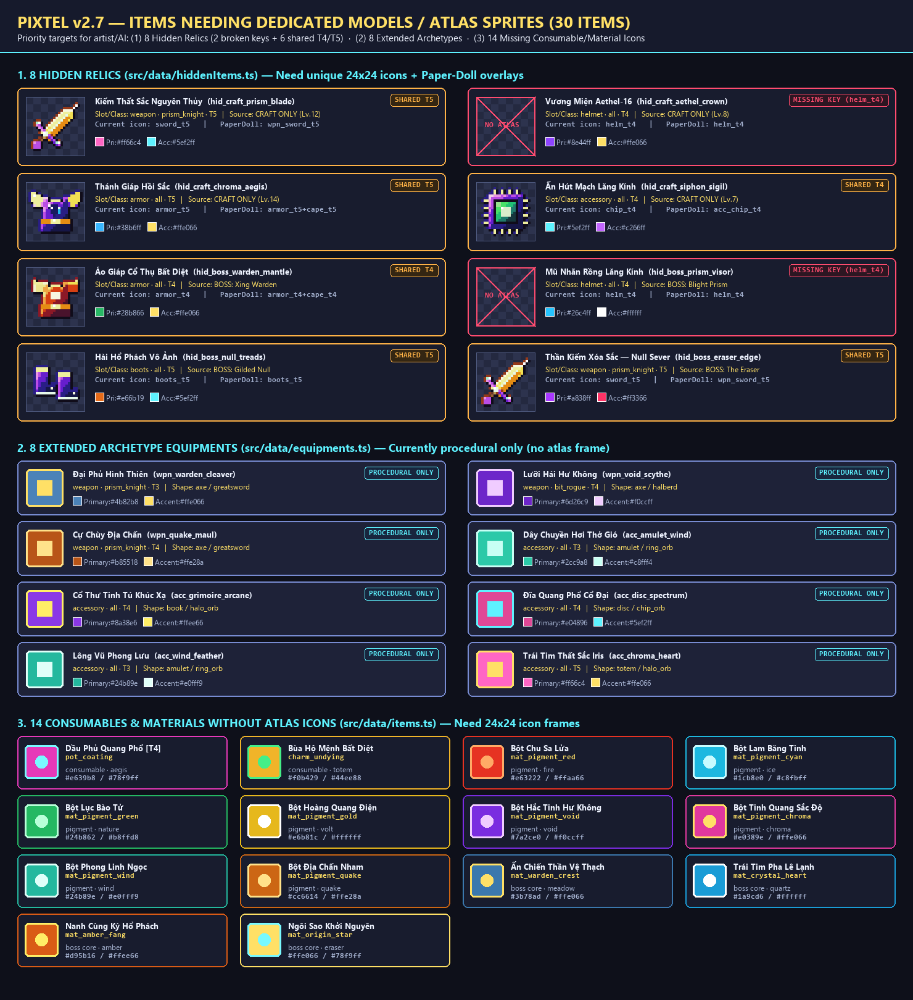
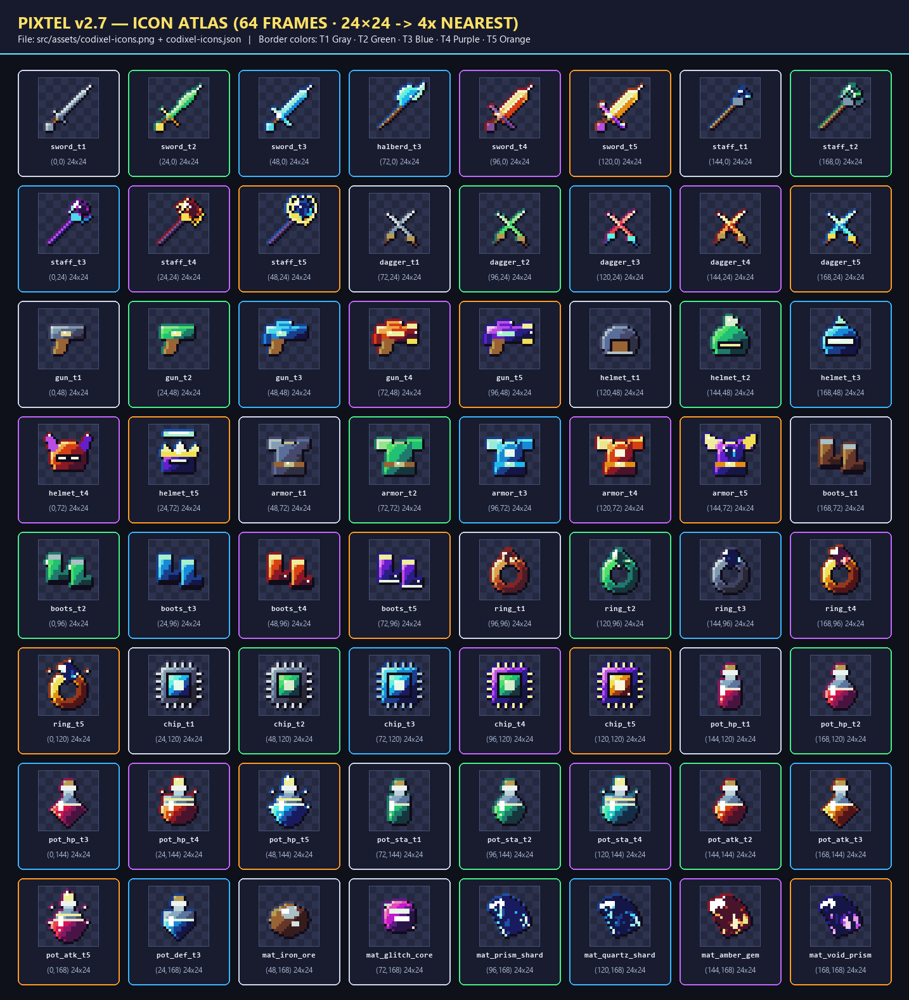
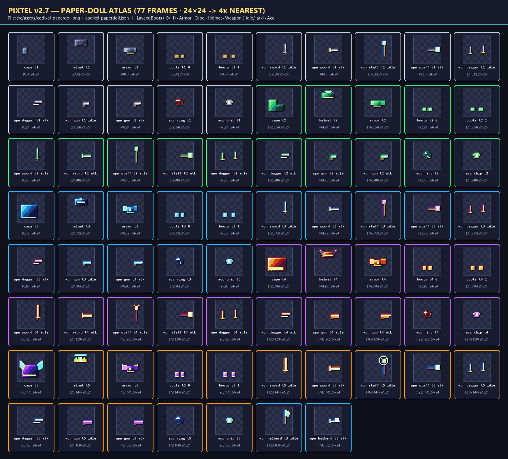
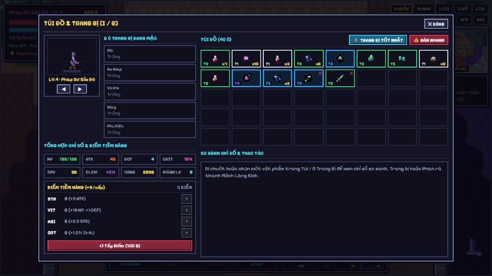
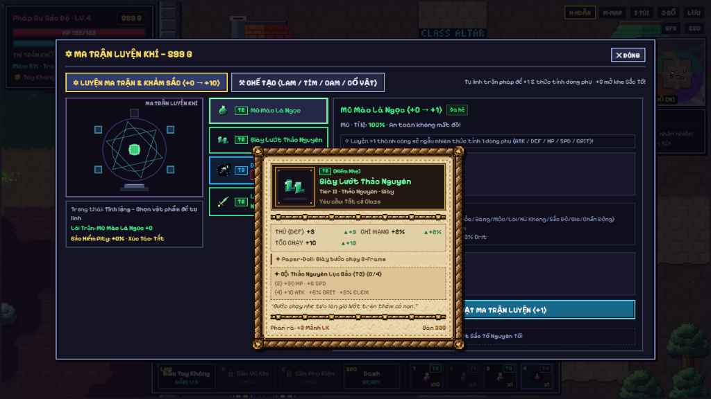

# PIXTEL v2.7 — Báo Cáo Hình Ảnh Hệ Thống Item & Model Sprite

Tài liệu trực quan tổng hợp toàn bộ **94 item** hiện có trong PixTel (**54** trang bị chính + **8** Cổ vật ẩn + **14** vật phẩm tiêu thụ + **18** nguyên liệu), kèm bảng đối chiếu các sprite `24×24 px` hiện tại trong atlas và **30 item cần vẽ/sửa model riêng** để gửi cho Artist / AI thiết kế lại.

---

## 1. Bảng Nhiệm Vụ Chỉnh Sửa Model (30 Item Cần Vẽ / Sửa)



### A. 8 Cổ Vật Ẩn (`src/data/hiddenItems.ts`) — Ưu tiên cao nhất
| ID | Tên tiếng Việt | Ô / Class | Nguồn nhận | Trạng thái hiện tại | Màu định hướng (`primary` / `accent`) |
|---|---|---|---|---|---|
| `hid_craft_prism_blade` | Kiếm Thất Sắc Nguyên Thủy | `weapon` (`prism_knight`) | Craft-only (T5, Lv.12) | Dùng chung `sword_t5` / `wpn_sword_t5` | `#ff66c4` / `#5ef2ff` |
| `hid_craft_aethel_crown` | Vương Miện Aethel-16 | `helmet` (`all`) | Craft-only (T4, Lv.8) | **Lỗi key `helm_t4`** (atlas là `helmet_t4`) → fallback procedural | `#8e44ff` / `#ffe066` |
| `hid_craft_chroma_aegis` | Thánh Giáp Hồi Sắc | `armor` (`all`) | Craft-only (T5, Lv.14) | Dùng chung `armor_t5` + `cape_t5` | `#38b6ff` / `#ffe066` |
| `hid_craft_siphon_sigil` | Ấn Hút Mạch Lăng Kính | `accessory` (`all`) | Craft-only (T4, Lv.7) | Dùng chung `chip_t4` / `acc_chip_t4` | `#5ef2ff` / `#c266ff` |
| `hid_boss_warden_mantle` | Áo Giáp Cổ Thụ Bất Diệt | `armor` (`all`) | Boss `Xing Warden` (T4) | Dùng chung `armor_t4` + `cape_t4` | `#28b866` / `#ffe066` |
| `hid_boss_prism_visor` | Mũ Nhãn Rồng Lăng Kính | `helmet` (`all`) | Boss `Blight Prism` (T4) | **Lỗi key `helm_t4`** (atlas là `helmet_t4`) → fallback procedural | `#26c4ff` / `#ffffff` |
| `hid_boss_null_treads` | Hài Hổ Phách Vô Ảnh | `boots` (`all`) | Boss `Gilded Null` (T5) | Dùng chung `boots_t5` | `#e66b19` / `#5ef2ff` |
| `hid_boss_eraser_edge` | Thần Kiếm Xóa Sắc — Null Sever | `weapon` (`prism_knight`) | World Boss `The Eraser` (T5) | Dùng chung `sword_t5` / `wpn_sword_t5` | `#a838ff` / `#ff3366` |

### B. 8 Trang Bị Archetype Mở Rộng (`src/data/equipments.ts`) — Chưa có frame atlas
| ID | Tên tiếng Việt | Ô / Class | Hình dáng (`iconKind` / `shape`) | Màu (`primary` / `accent`) |
|---|---|---|---|---|
| `wpn_warden_cleaver` | Đại Phủ Hình Thiên | `weapon` (`prism_knight`, T3) | `axe` / `greatsword` | `#4b82b8` / `#ffe066` |
| `wpn_void_scythe` | Lưỡi Hái Hư Không | `weapon` (`bit_rogue`, T4) | `axe` / `halberd` | `#6d26c9` / `#f0ccff` |
| `wpn_quake_maul` | Cự Chùy Địa Chấn | `weapon` (`prism_knight`, T4) | `axe` / `greatsword` | `#b85518` / `#ffe28a` |
| `acc_amulet_wind` | Dây Chuyền Hơi Thở Gió | `accessory` (`all`, T3) | `amulet` / `ring_orb` | `#2cc9a8` / `#c8fff4` |
| `acc_grimoire_arcane` | Cổ Thư Tinh Tú Khúc Xạ | `accessory` (`all`, T4) | `book` / `halo_orb` | `#8a38e6` / `#ffee66` |
| `acc_disc_spectrum` | Đĩa Quang Phổ Cổ Đại | `accessory` (`all`, T4) | `disc` / `chip_orb` | `#e04896` / `#5ef2ff` |
| `acc_wind_feather` | Lông Vũ Phong Lưu | `accessory` (`all`, T3) | `amulet` / `ring_orb` | `#24b89e` / `#e0fff9` |
| `acc_chroma_heart` | Trái Tim Thất Sắc Iris | `accessory` (`all`, T5) | `totem` / `halo_orb` | `#ff66c4` / `#ffe066` |

### C. 14 Vật Phẩm Tiêu Thụ & Nguyên Liệu Chưa Có Icon Atlas (`src/data/items.ts`)
- **Tiêu thụ (2):** `pot_coating` (*Dầu Phủ Quang Phổ* `#e639b8`/`#78f9ff`), `charm_undying` (*Bùa Hộ Mệnh Bất Diệt* `#f0b429`/`#44ee88`).
- **8 Bột Sắc Tố (`+5` Khảm nguyên tố):** `mat_pigment_red` (Lửa), `mat_pigment_cyan` (Băng), `mat_pigment_green` (Mộc), `mat_pigment_gold` (Lôi), `mat_pigment_void` (Hư Không), `mat_pigment_chroma` (Sắc Độ), `mat_pigment_wind` (Gió), `mat_pigment_quake` (Địa Chấn).
- **4 Lõi Boss:** `mat_warden_crest`, `mat_crystal_heart`, `mat_amber_fang`, `mat_origin_star`.

---

## 2. Toàn Bộ Icon Atlas Hiện Có (`codixel-icons.png` — 64 Frame, `24×24`)



---

## 3. Toàn Bộ Paper-Doll Atlas Hiện Có (`codixel-paperdoll.png` — 77 Frame, `24×24`)



---

## 4. Ảnh Tham Chiếu Hiển Thị Thực Tế Trong Game

| Túi đồ & Paper-Doll `[I / B]` | Ma Trận Luyện Khí `[F]` |
|---|---|
|  |  |

---

## 5. Danh Sách File Cần Gửi Kèm Cho AI Chỉnh Model

- **Dữ liệu Item & Key Atlas:**
  - `src/data/equipments.ts`
  - `src/data/hiddenItems.ts`
  - `src/data/items.ts`
  - `src/data/types.ts`
- **Tài nguyên Sprite Atlas & Script Sinh Pixel:**
  - `src/assets/codixel-icons.png` & `src/assets/codixel-icons.json`
  - `src/assets/codixel-paperdoll.png` & `src/assets/codixel-paperdoll.json`
  - `scripts/generate_codixel_assets.mjs`
- **Code Render Trên Canvas & UI:**
  - `src/graphics/codixelAtlas.ts` (vẽ `24×24` sắc nét + tự sinh bản `Bleached` khử màu)
  - `src/graphics/heroSprites.ts` (thứ tự layer nhân vật: Chân/Giày → Áo choàng → Thân → Áo giáp → Mũ → Phụ kiện → Vũ khí)
  - `src/graphics/pixelCraft.ts` (vẽ procedural fallback khi item chưa có frame trong atlas)

---

## 6. Prompt Mẫu Gửi Cho AI Của Bạn

```text
Đọc kỹ báo cáo docs/ITEM_VISUAL_REPORT.md cùng các file src/data/equipments.ts, src/data/hiddenItems.ts, src/data/items.ts, src/assets/codixel-icons.{png,json}, src/assets/codixel-paperdoll.{png,json}, src/graphics/codixelAtlas.ts và scripts/generate_codixel_assets.mjs.

Hãy thiết kế lại và bổ sung sprite pixel art 16-bit (chuẩn 24x24 px mỗi frame, nền trong suốt, viền tối 1px sắc nét, không anti-aliasing) cho:
1. 8 Cổ Vật Ẩn trong src/data/hiddenItems.ts (tạo spriteKey + paperDollKey riêng biệt thay cho việc dùng chung T4/T5, và sửa key lỗi "helm_t4" ở hid_craft_aethel_crown & hid_boss_prism_visor).
2. 8 trang bị Archetype mở rộng trong src/data/equipments.ts (wpn_warden_cleaver, wpn_void_scythe, wpn_quake_maul, acc_amulet_wind, acc_grimoire_arcane, acc_disc_spectrum, acc_wind_feather, acc_chroma_heart).
3. 14 item tiêu thụ & nguyên liệu còn thiếu icon trong src/data/items.ts (pot_coating, charm_undying, 8 mat_pigment_*, 4 lõi Boss).

Ràng buộc kỹ thuật:
- Giữ nguyên toàn bộ key cũ đang được Tier 1–5 sử dụng để không vỡ UI hiện tại.
- Với Paper-Doll mới: vũ khí cần đủ 2 frame `<key>_idle` và `<key>_atk`; giày cần `<key>_0` và `<key>_1`; giáp nếu có áo choàng đi kèm thì gắn `capeKey`.
- Cập nhật đúng tọa độ vào codixel-icons.json và codixel-paperdoll.json, chạy `npm test` và `npm run build` để kiểm tra không lỗi.
```
