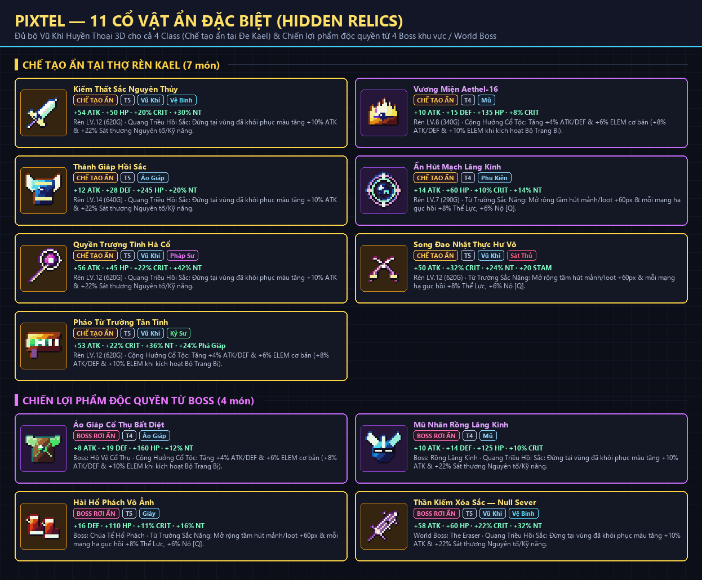
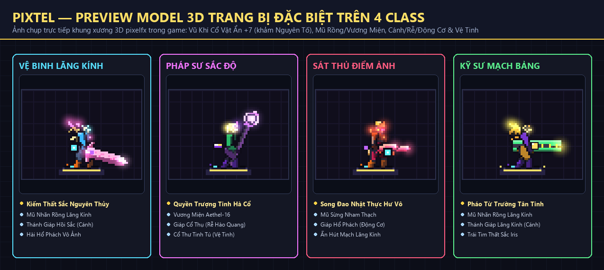
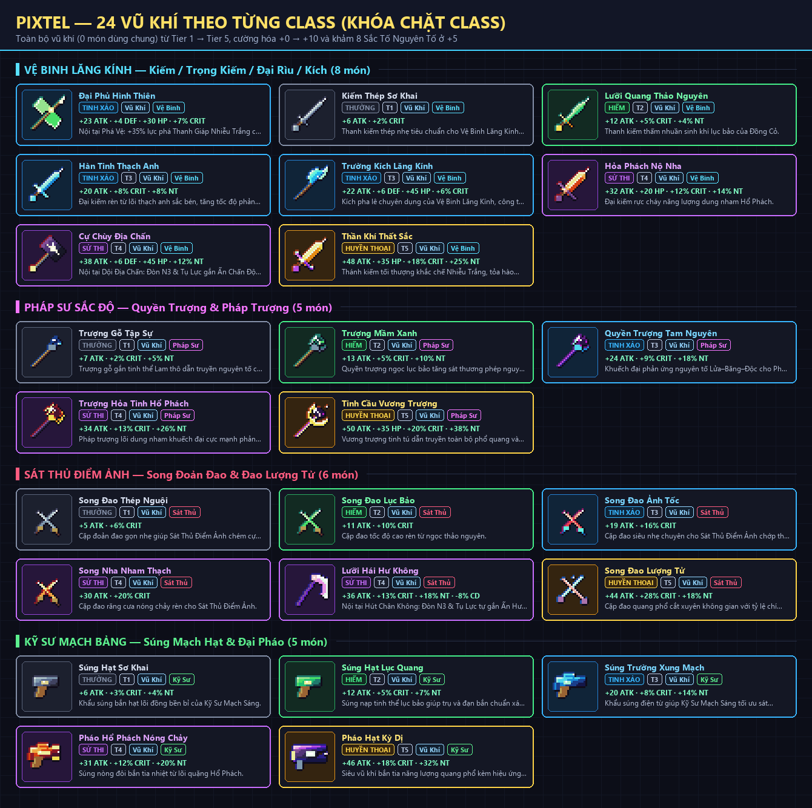
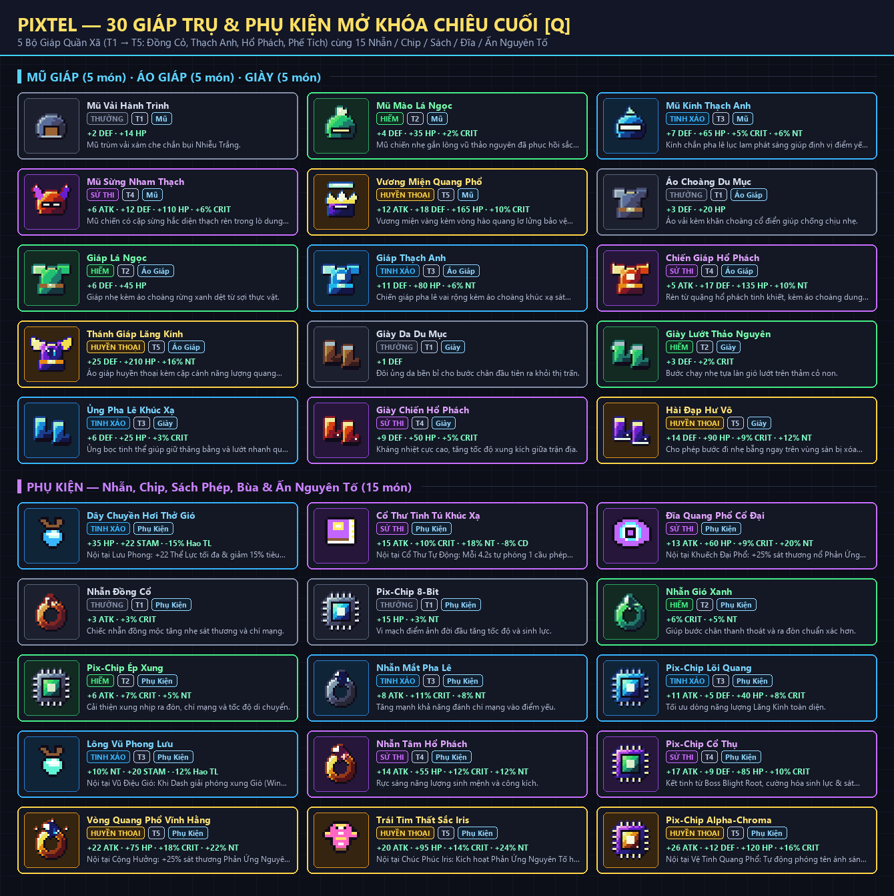
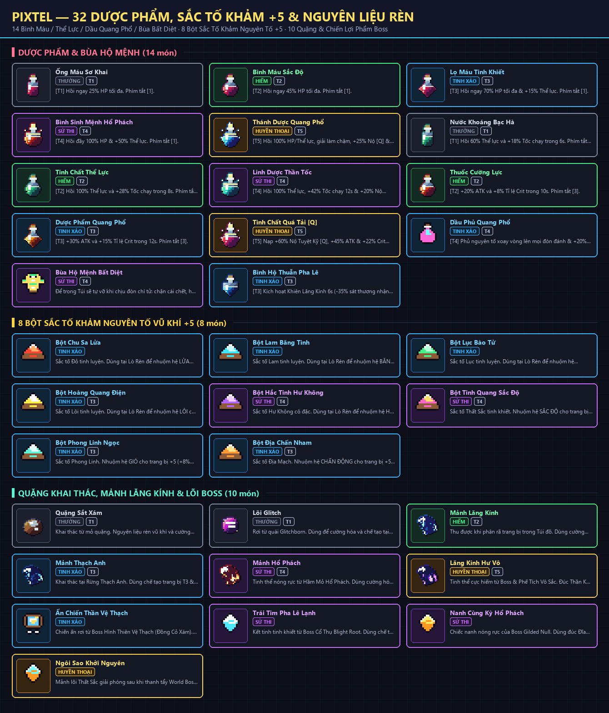

# PIXTEL — Thư Viện Preview Toàn Bộ 97 Vật Phẩm Cơ Bản & Cổ Vật Ẩn (v2.7+)

> Toàn bộ **97 vật phẩm cốt lõi** (vẽ bằng bộ icon pixel `codixel-icons.png` & ma trận pixel 16-bit gốc trong game) cùng **ảnh chụp 3D `pixelfx` thực tế trên cả 4 Class**. *(Xem thêm 33 vật phẩm Độc Lạ, Đồ Mùa, Chìa Biome & Balo mới thêm ở [2026-11-26-v3.0-new-items-preview.md](2026-11-26-v3.0-new-items-preview.md).)*

---

## 1. 11 Cổ Vật Ẩn (`Hidden Relics` — Chế Tạo Ẩn & Chiến Lợi Phẩm Boss)

## 2. Preview 3D Trang Bị Đặc Biệt trên cả 4 Class (`pixelfx`)

## 3. 24 Vũ Khí Khóa Chặt Theo 4 Class (Tier 1 → Tier 5)

## 4. 30 Giáp Trụ & Phụ Kiện

## 5. 32 Dược Phẩm, 8 Bột Sắc Tố Khảm `+5` & Nguyên Liệu Rèn

---

## Tổng Quan Phân Bố 97 Vật Phẩm Cơ Bản

| Nhóm vật phẩm | Số lượng | Đặc điểm nổi bật | Nguồn file dữ liệu |
| :--- | :---: | :--- | :--- |
| **Cổ Vật Ẩn (`Hidden Relics`)** | **11** | `7` món **Chế Tạo Ẩn** tại Đe Thợ Rèn Kael (đủ vũ khí Huyền Thoại cho cả 4 Class) + `4` món **Boss Độc Quyền** (100% rơi ở lần hạ đầu) | [hiddenItems.ts](../src/data/hiddenItems.ts) |
| **Vũ Khí Thường → Huyền Thoại** | **24** | **Khóa chặt 100% theo Class** (`8` Vệ Binh · `5` Pháp Sư · `6` Sát Thủ · `5` Kỹ Sư), rèn `+0 → +10` & khảm 8 Nguyên Tố ở `+5` | [equipments.ts](../src/data/equipments.ts) |
| **Giáp Trụ (Mũ / Áo / Giày)** | **15** | 5 bộ quần xã `T1 → T5` (*Du Mục, Đồng Cỏ, Thạch Anh, Hổ Phách, Phế Tích*) kích hoạt Set Bonus 2/3/4 món | [equipments.ts](../src/data/equipments.ts) |
| **Phụ Kiện (Nhẫn / Chip / Sách / Đĩa / Ấn)** | **15** | Nhiều món có nội tại riêng (*Cổ Thư Tự Động*, *Vũ Điệu Gió*, *Chúc Phúc Iris*, *Vệ Tinh Quang Phổ*) | [items.ts](../src/data/items.ts) |
| **Dược Phẩm & Bùa Hộ Mệnh** | **14** | Phím tắt `[1]` Máu, `[2]` Thể Lực/Tốc Chạy, `[3]` Buff ATK/Crit/Nộ, `[4]` Dầu Phủ Quang Phổ + *Bùa Hộ Mệnh Bất Diệt* tự kích hoạt | [items.ts](../src/data/items.ts) |
| **Bột Sắc Tố Khảm `+5`** | **8** | Đủ 8 hệ nguyên tố (*Hỏa, Băng, Mộc, Lôi, Hư Không, Sắc Độ, Gió, Chấn Động*) để kích hoạt 29 Phản Ứng Nguyên Tố | [items.ts](../src/data/items.ts) |
| **Quặng, Mảnh & Lõi Boss** | **10** | 6 nguyên liệu khai thác/phân rã + 4 chiến lợi phẩm Boss (*Ấn Chiến Thần, Trái Tim Pha Lê, Nanh Cùng Kỳ, Ngôi Sao Khởi Nguyên*) | [items.ts](../src/data/items.ts) |
