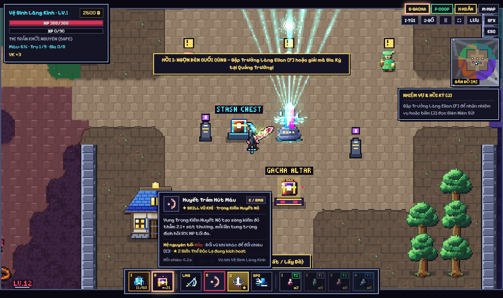
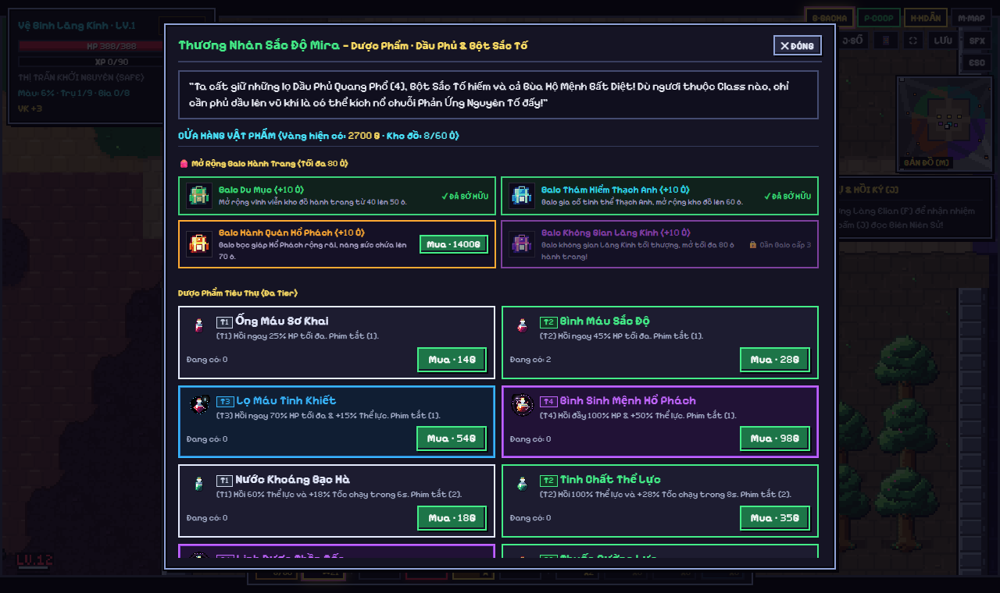
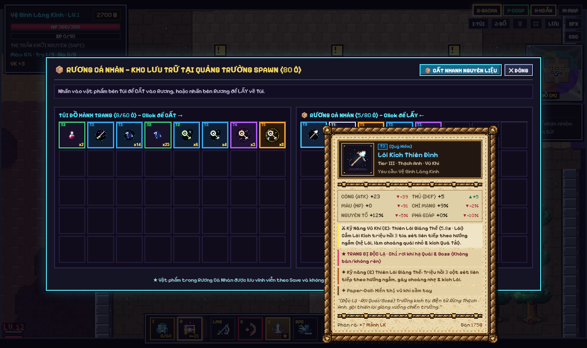
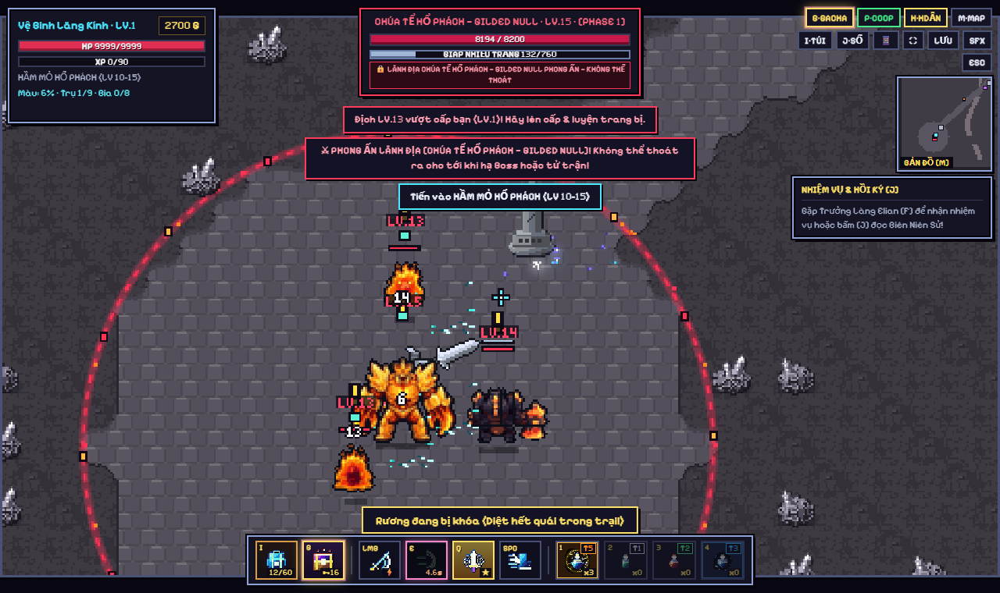

# PIXTEL v3.0+ — Preview Gameplay, UI/UX, Gacha Mùa, Auto-Bán, Balo & Rương Cá Nhân

> **Ngày cập nhật:** `2026-11-26` · **Phiên bản:** `PIXTEL v3.0+` · **Trạng thái kiểm chứng:** `16/16` test suites PASS · `npm run build` OK · `0` lỗi console/page trên Chrome · Font số `PixTel Digits` đã sửa sắc nét (`5` vs `8`).

---

## 1. Quảng Trường Spawn — Rương Cá Nhân, Đài Gacha Mùa & Thanh Kỹ Năng Vũ Khí Động

- **Rương Cá Nhân (`STASH CHEST`)** đặt ngay cạnh điểm Spawn (`tx: 77, ty: 82`) — lại gần nhấn `[F]` để cất/lấy đồ an toàn (`80` ô).
- **Đài Rương Gacha Mùa (`GACHA ALTAR`)** phát sáng ngay phía nam quảng trường (mở bằng `[F]` hoặc phím nhanh **`[G]`** ở mọi nơi).
- **Thanh HUD dưới cùng:**
  - **`[I]` Balo Pixel động:** Tự đổi hình Balo theo cấp nâng cấp (`40 → 50 → 60 → 70 → 80` ô).
  - **`[G]` Rương Gacha Mùa:** Nhấp nháy vàng kèm tổng số Chìa Khóa Mùa đang giữ.
  - **`[E]` Kỹ Năng Vũ Khí Động (`41` bộ chiêu):** Đổi vũ khí sẽ đổi lập tức icon pixel, màu viền nguyên tố, hồi chiêu, hiệu ứng `pixelfx` & tooltip khi rê chuột.
  - **`[Q]` Kỹ Năng Cố Định Class:** Luôn mở khóa khi tích đủ 100% Nộ (không còn bị khóa sau ô Phụ Kiện).

---

## 2. Auto-Bán Vật Phẩm Phẩm Chất Thấp & Mở Rộng Balo (`40 → 80` Ô)

### Túi Đồ `[I]` — Thanh Auto-Bán Khi Nhặt & Nâng Cấp Balo Nhanh
- Chọn ngưỡng **`TẮT` / `TRẮNG` / `≤ LỤC` / `≤ LAM`** + tùy chọn **`☑ Khác Class`**. Khi đi qua đồ rớt đủ điều kiện sẽ tự hút & đổi thẳng thành Vàng (`AUTO +XG`), không tốn ô túi. Có thêm nút **`🧹 QUÉT`** để dọn ngay đồ phẩm thấp đang nằm sẵn trong túi.
- **Bảo vệ an toàn tuyệt đối:** Không bao giờ tự bán Cổ Vật Ẩn (`isHidden`), Trang Bị Độc Lạ (`dropOnly`), Đồ Độc Quyền Mùa (`seasonalBannerId`) hoặc bất kỳ trang bị nào đã cường hóa (`+1` trở lên).

![Túi Đồ [I]: Thanh Auto-Bán khi nhặt, nút mua Balo +10 ô và chi tiết Vũ Khí Độc Lạ](./assets/v3_preview_2_inventory_autosell_backpack.png)

### Thương Nhân Mira — Quầy Mua 4 Cấp Balo Mở Rộng (`40 → 50 → 60 → 70 → 80` Ô)
- 4 cấp Balo `codixel` riêng biệt: **Du Mục `50` ô (`250G`) → Thạch Anh `60` ô (`650G`) → Hổ Phách `70` ô (`1400G`) → Không Gian Lăng Kính `80` ô (`2800G`)**.

---

## 3. Rương Cá Nhân Tại Spawn (`80` Ô Lưu Trữ Vĩnh Viễn)

- Đặt ngay cạnh Trụ Khởi Nguyên (`STASH CHEST`) — tương tác **`[F]`** mở kho 2 cột **Túi Đồ ↔ Rương Cá Nhân**.
- Click 1 chạm để **Cất vào Rương** hoặc **Lấy về Túi**, kèm nút **`📦 CẤT NHANH NGUYÊN LIỆU`** (tự giữ lại Chìa Rương Mùa trong túi).
- Hỗ trợ **đầy đủ khung xem chỉ số rê chuột** (`ItemReviewTooltip`) cho cả đồ nằm trong Rương, hiển thị rõ **Kỹ Năng Vũ Khí `[E]`** & nhãn **★ TRANG BỊ ĐỘC LẠ**.
- Đồ cất trong Rương Cá Nhân được lưu bền theo Save và **không bị ảnh hưởng khi Đổi Class**.

---

## 4. Đài Rương Gacha Theo Mùa (`[G]`) & 4 Chìa Khóa Quần Xã

- Toàn bộ 25 rương trại farm & rương Trụ Sắc Màu trên bản đồ đã được dọn gọn — **chỉ còn duy nhất 4 Rương Chính tại 4 Đấu Trường Boss** (mở ra chắc chắn kèm Chìa Mùa tương ứng).
- **4 Chìa Khóa Mùa** (*Xuân / Đông / Hạ / Nhật Thực*) rơi tỉ lệ thấp từ quái đúng vùng hoặc chế tạo tại Lò Rèn Kael.
- Sân khấu Canvas 60FPS có **tra chìa → xoay khóa → rung lắc tăng nhịp tim chiptune → tia sáng bùng nổ → sét xé màn hình `"★ LẬT KÈO NÂNG PHẨM! ★"` → mưa sao confetti & thẻ lật 3D (Quay ×1 / ×5)**, kèm nút **Mặc Ngay**, bảo hiểm **Pity 10/25** minh bạch & tự quy đổi đồ trùng thành **Mảnh Lăng Kính + Vàng**.

![Sân khấu Đài Rương Gacha Theo Mùa [G] sau lượt Mở x5: confetti cầu vồng, thẻ Lật Kèo và nút Mặc Ngay](./assets/v3_preview_5_gacha_5x_reveal.png)

---

## 5. Quái & Boss HD (`306` Frame `:atk`) + Cân Bằng Độ Khó Hardcore

- Toàn bộ **19 loài quái & Boss** được nâng độ phân giải +22%, lọc nét & bổ sung sprite đánh **`:atk`** ở cả 4 hướng, kèm **tia cảnh báo đòn 4 cánh (Danger Glint)**, **chấm than `"!"` gọi bầy đàn (`125px`)**, giật lùi trúng đòn và hiệu ứng xuất hiện cổng màu.
- Quái & Boss được cân bằng cứng cáp hơn (HP ~1.7–2.0×, ATK ~1.45×, Giáp Trắng dày, siết phạt vượt cấp `gap > 1`, bình máu hồi chiêu `2.5s`) để tạo vòng lặp RPG chuẩn: **Farm bãi quái → Nhặt đồ Độc Lạ / Chìa Mùa → Làm nhiệm vụ & Cường hóa → Phá đảo Boss**.

