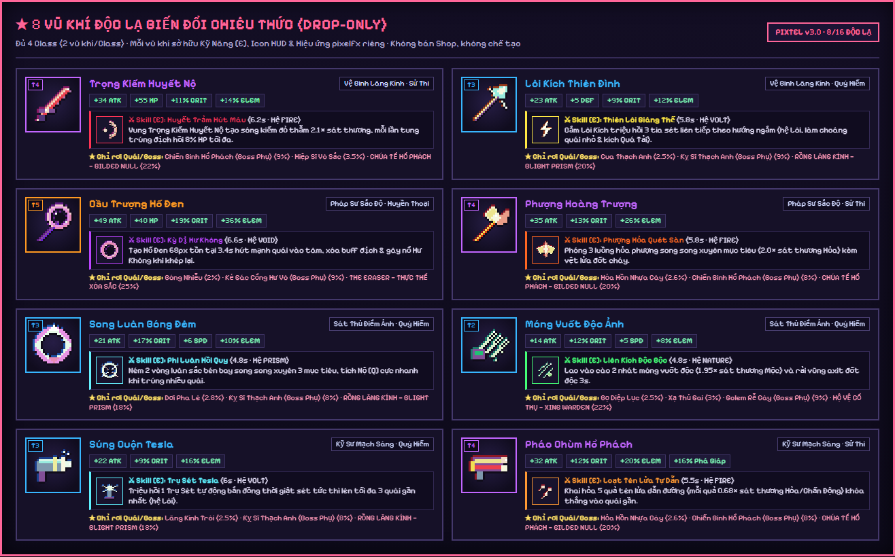
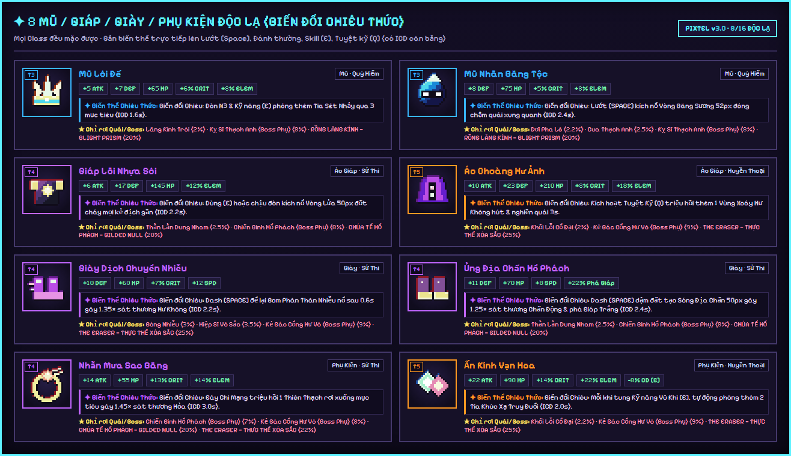
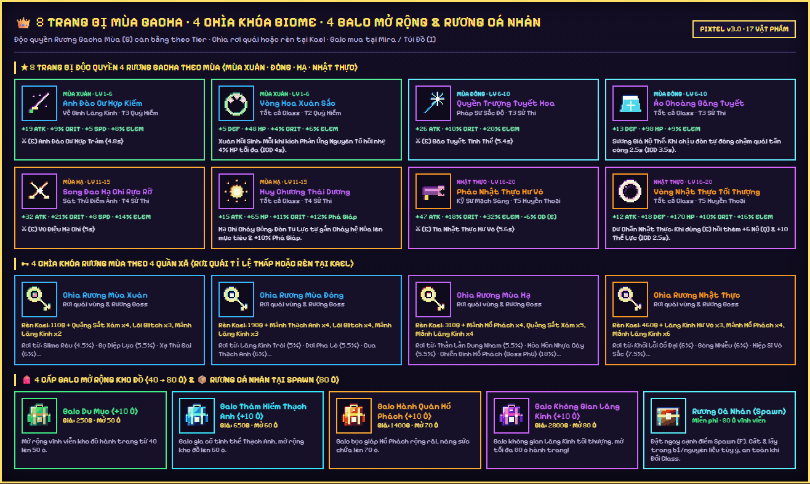

# PIXTEL v3.0+ — Bảng Preview Toàn Bộ 33 Vật Phẩm & Nâng Cấp Mới

> **Ngày cập nhật:** `2026-11-26` · **Phiên bản:** `PIXTEL v3.0+` · Tổng cộng **33 vật phẩm / nâng cấp mới** kèm icon pixel `24×24` (`codixel`) và model 3D (`pixelfx`) riêng: **16 Trang Bị Độc Lạ** (chỉ rơi Quái/Boss), **8 Trang Bị Độc Quyền 4 Mùa Gacha**, **4 Chìa Khóa Quần Xã**, **4 Cấp Balo Mở Rộng (`40 → 80` ô)** và **Rương Cá Nhân (`80` ô) ngay tại Spawn**.

---

## 1. 8 Vũ Khí Độc Lạ Biến Đổi Chiêu Thức (Chỉ Rơi Quái & Boss)

Mỗi Class có **2 Vũ Khí Độc Lạ** mới với **Kỹ Năng `[E]` + Icon HUD + hiệu ứng `pixelfx` hoàn toàn riêng biệt** (tuyệt đối không bán Shop, không chế tạo, không rò rỉ vào rương ngẫu nhiên).

---

## 2. 8 Mũ / Giáp / Giày / Phụ Kiện Độc Lạ (Chỉ Rơi Quái & Boss)

Dùng chung cho mọi Class — gắn trực tiếp **Biến Thể Chiêu Thức** lên Đánh Thường N3, Lướt `[Space]`, Kỹ Năng Vũ Khí `[E]`, Tuyệt Kỹ `[Q]` và Đòn Chí Mạng (có hồi nội tại ICD cân bằng để không phá vỡ độ khó).

---

## 3. 8 Trang Bị Rương Mùa · 4 Chìa Khóa Biome · 4 Balo Mở Rộng & Rương Cá Nhân

- **8 Trang Bị Độc Quyền 4 Mùa** (*Mùa Xuân*, *Mùa Đông*, *Mùa Hạ*, *Nhật Thực*): Mở từ **Đài Rương Gacha Theo Mùa `[G]`**, cân bằng chỉ số chuẩn theo từng Tier quần xã (`T2 → T5`).
- **4 Chìa Khóa Quần Xã:** Rơi tỉ lệ thấp từ quái đúng vùng, rơi chắc chắn ở Rương Đấu Trường Boss tương ứng, hoặc đúc tại **Thợ Rèn Kael**.
- **4 Cấp Balo Mở Rộng (`40 → 80` Ô) & Rương Cá Nhân (`80` Ô):** Mua Balo tại **Thương Nhân Mira** hoặc ngay góc Túi Đồ `[I]`; cất đồ miễn phí không lo đổi Class tại **Rương Cá Nhân (`STASH CHEST`)** ngay cạnh điểm Spawn.

