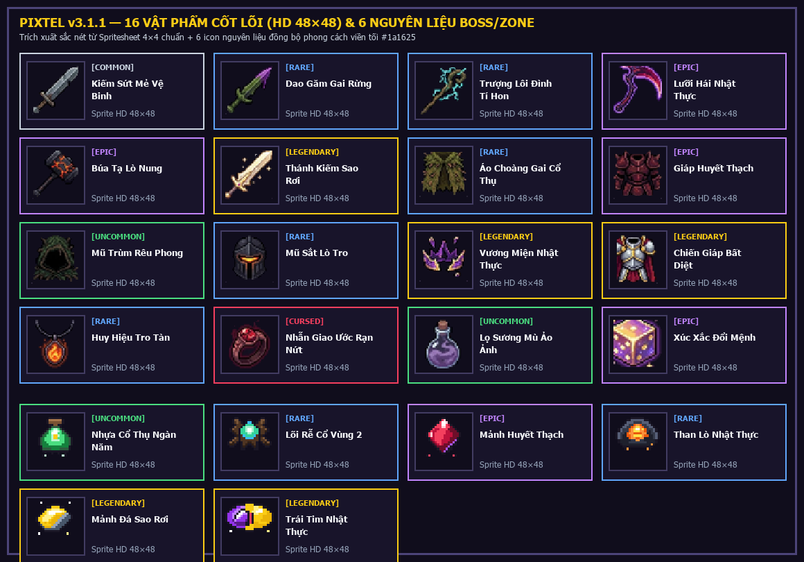
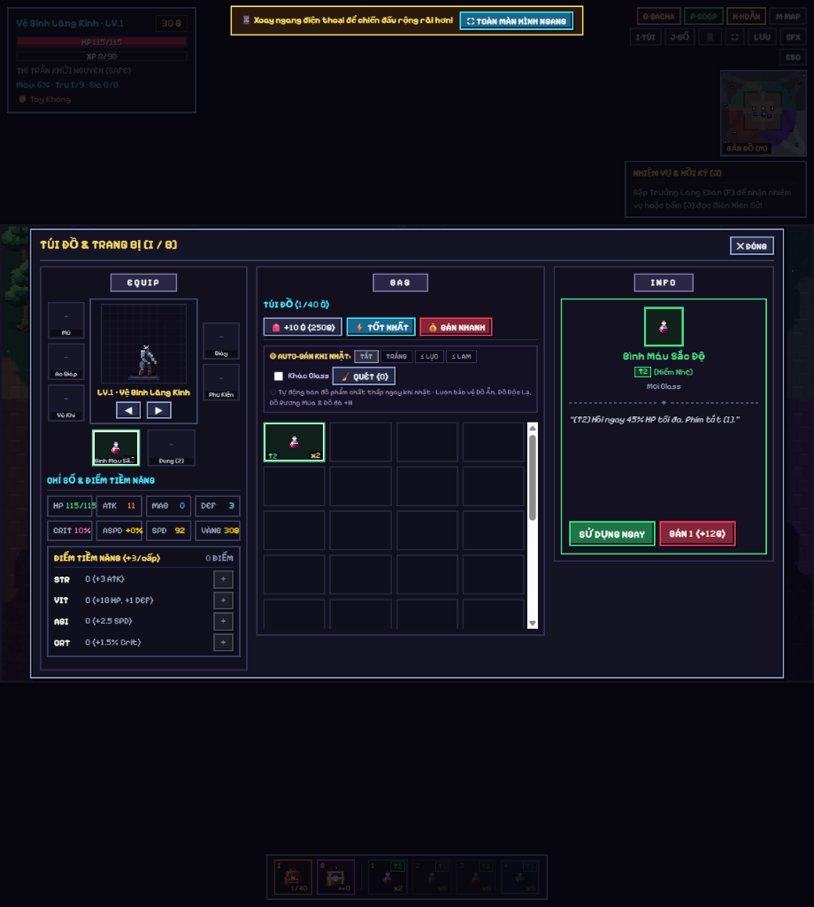
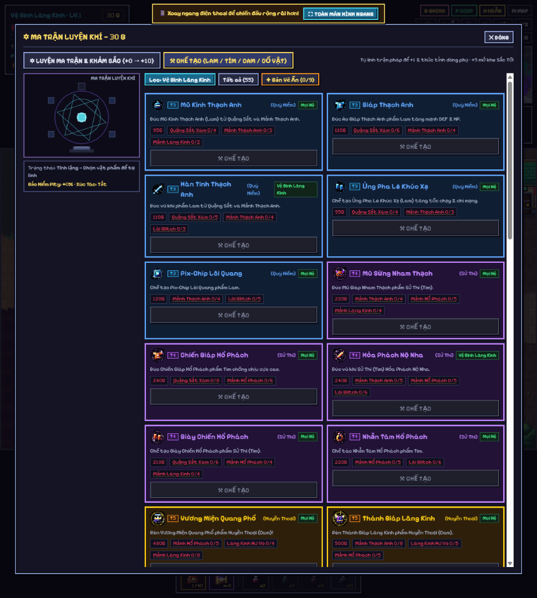

# PIXTEL v3.1 — Hệ Thống 16 Vật Phẩm Cốt Lõi, Nội Tại (`ItemEffectSystem`), 3 Set Bonus `(x/3)`, Lò Rèn Ẩn & UI 3 Cột 16-Bit

> **Ngày cập nhật:** `2026-11-26` · **Phiên bản:** `PIXTEL v3.1` · **Kiểm tra:** `tsc --noEmit && vite build` (`0` lỗi) · `17/17` Automated Feature Suites PASS.

Bản cập nhật này hoàn thiện hệ thống vật phẩm RPG 16-bit tách biệt Data/Logic (`src/types/item.ts`, `src/data/sets.ts`, `src/systems/ItemEffectSystem.ts`), bổ sung **16 vật phẩm cốt lõi** (kèm phẩm chất mới **`cursed: #f43f5e`**), **6 nguyên liệu Boss/Zone**, **3 Bộ Trang Bị 3 món `(2/3)` & `(3/3)`**, **2 Công thức Lò Rèn Ẩn (`isHidden: true`)**, **Đổi Mệnh bằng Xúc Xắc** và **Giao diện Túi đồ 3 cột 16-bit (`EQUIP` · `BAG` · `INFO`)**.

---

## 1. Spritesheet 16 Vật Phẩm Cốt Lõi (Lưới 4×4) & 6 Nguyên Liệu Boss/Zone

Toàn bộ 22 icon pixel `24×24` mới (viền tối `#1a1625`) được sinh trong `scripts/generate_codixel_assets.mjs` và đóng gói vào `src/assets/codixel-icons.png` / `.json` (`165` icon).

### Danh sách 16 Vật phẩm cốt lõi (`CORE_16_ITEMS`)

| # | ID | Tên vật phẩm | Độ hiếm | Class / Ô | Chỉ số chính | Nội tại / Kích hoạt |
|---|---|---|---|---|---|---|
| 1 | `wp_vanguard_chipped` | Kiếm Sứt Mẻ Vệ Binh | `common` | `prism_knight` · Vũ khí | `+7 ATK` | Đồ mồi mở công thức ẩn **Thánh Kiếm Sao Rơi** khi hạ Boss Vùng 2 |
| 2 | `wp_briar_dagger` | Dao Găm Gai Rừng | `rare` | `bit_rogue` · Vũ khí (`set_forest`) | `+12 ATK`, `+12% ASPD` | `bleed_crit`: Chí mạng gây chảy máu `4% ATK/s` trong `3s` (tối đa 3 lớp) |
| 3 | `wp_spark_staff` | Trượng Lôi Đình Tí Hon | `rare` | `chroma_mage` · Vũ khí | `+16 MAG`, `+10% ASPD` | `chain_lightning`: Mỗi đòn thứ 3 phóng sét nảy 2 mục tiêu (`50% DMG`) |
| 4 | `wp_eclipse_reaver` | Lưỡi Hái Nhật Thực | `epic` | `bit_rogue` · Vũ khí (`set_eclipse`) | `+30 ATK`, `-5 DEF`, `+8% Hút máu` | `eclipse_lifesteal`: Hút `8%` máu; đòn thứ 4 chém lan hình bán nguyệt |
| 5 | `wp_forge_hammer` | Búa Tạ Lò Nung | `epic` | `prism_knight` · Vũ khí (`set_forge`) | `+26 ATK`, `-8% MoveSpeed` | `quake_stun`: Đòn thứ 4 đập đất choáng `1s` bán kính `48px` |
| 6 | `wp_starfall_blade` | Thánh Kiếm Sao Rơi | `legendary` | `prism_knight` · Vũ khí (`craft_only`) | `+46 ATK`, `+15% Crit` | `starfall_crit`: Chí mạng gọi sao rơi `140% ATK AoE` (`CD 6s`) |
| 7 | `ar_briar_cloak` | Áo Choàng Gai Cổ Thụ | `rare` | Mọi Class · Áo (`set_forest`) | `+14 DEF`, `+35 HP` | `thorns_regen`: Phản `20%` sát thương cận chiến; đứng yên `3s` hồi `2% HP/s` |
| 8 | `ar_bloodstone_plate` | Giáp Huyết Thạch | `epic` | Mọi Class · Áo (`set_eclipse`) | `+24 DEF`, `+65 HP` | `blood_shield`: Hạ quái nhận khiên `5% MaxHP` (tối đa 3 lớp, `10s`) |
| 9 | `hm_moss_hood` | Mũ Trùm Rêu Phong | `uncommon` | Mọi Class · Mũ (`set_forest`) | `+5 DEF`, `+15 HP` | `stealth_range`: Giảm `25%` tầm phát hiện của quái |
| 10 | `hm_ash_visor` | Mũ Sắt Lò Tro | `rare` | Mọi Class · Mũ (`set_forge`) | `+12 DEF`, `+15% FireRes` | `burn_immune`: Miễn nhiễm Thiêu Đốt |
| 11 | `hm_eclipse_crown` | Vương Miện Nhật Thực Vỡ | `legendary` | Mọi Class · Mũ (`set_eclipse`, Boss 5%) | `+18 DEF`, `+20 MAG`, `+10% Hút máu` | `eclipse_slow`: Khi `HP < 35%`, làm chậm quái xung quanh `40%` trong `4s` (`CD 25s`) |
| 12 | `ar_aegis_mantle` | Chiến Giáp Vệ Binh Bất Diệt | `legendary` | Mọi Class · Áo (`craft_only`) | `+36 DEF`, `+110 HP` | `undying_wall`: 1 lần/`45s`, chặn đòn tử vong giữ `1 HP` và bất tử `2s` |
| 13 | `ac_ember_crest` | Huy Hiệu Tro Tàn | `rare` | Mọi Class · Phụ kiện (`set_forge`) | `+8 ATK`, `+10% FireRes` | `ember_nova`: Khi `HP < 30%`, nổ lửa đẩy lùi quái + khiên `20% MaxHP` (`CD 30s`) |
| 14 | `ac_cracked_pact` | Nhẫn Giao Ước Rạn Nứt | `cursed` | Mọi Class · Phụ kiện | `+35% CritDMG`, `+12% Crit` | `pact_drain` (*Nguyền Rủa*): Hạ quái mất `3% HP` hiện tại (không gây chết) |
| 15 | `cs_mirage_vial` | Lọ Sương Mù Ảo Ảnh | `uncommon` | Tiêu hao | — | Tàng hình `2.5s` (quái mất aggro) + `+40%` tốc chạy |
| 16 | `cs_fate_die` | Xúc Xắc Đổi Mệnh | `epic` | Tiêu hao (Lò Rèn) | — | Dùng tại Lò Rèn Kael để reroll chỉ số phụ của 1 trang bị |

---

## 2. Giao Diện Túi Đồ 3 Cột 16-Bit (`EQUIP` · `BAG` · `INFO`)

Ảnh chụp thực tế từ trình duyệt (`#modal-inventory`):
- **Cột trái (`EQUIP`):** Khung Paper-doll hiển thị Z-order (`Aura -> Áo choàng -> Thân -> Giáp -> Mũ -> Vũ khí`) bao quanh bởi các ô trang bị + 2 ô tiêu hao nhanh, cùng bảng chỉ số & điểm tiềm năng.
- **Cột giữa (`BAG`):** Lưới 4 cột vuông vức với viền màu theo 6 độ hiếm (`common: #cbd5e1`, `uncommon: #4ade80`, `rare: #60a5fa`, `epic: #c084fc`, `cursed: #f43f5e` nhấp nháy `cursedPulse`, `legendary: #facc15`).
- **Cột phải (`INFO`):** Hiển thị Icon, Tên theo màu độ hiếm, so sánh chỉ số xanh/đỏ, khối Passive/Curse vàng cam kèm CD, Set Bonus `(x/3)`, đường kẻ pixel ngang và Lore chữ nghiêng `#cbd5e1`.

---

## 3. Lò Rèn Ẩn, Đổi Mệnh & 3 Set Bonus `(x/3)`

Ảnh chụp thực tế Ma Trận Luyện Khí của Thợ Rèn Kael (`#modal-forge` — tab Chế Tạo): các công thức **`isHidden: true`** hoàn toàn bị ẩn trước khi người chơi đạt điều kiện mở khóa.

### Tóm tắt 3 Bộ Trang Bị `(x/3)` & Điều kiện Lò Rèn Ẩn
- **Bộ Rừng Sương Mù (`set_forest`):** `(2/3)` `+10 SPD · +8% Crit` · `(3/3)` `+15% ASPD · +25 HP · Hào Quang Rừng Cổ`
- **Bộ Tâm Lò Tro Tàn (`set_forge`):** `(2/3)` `+12 ATK · +15% Kháng Lửa` · `(3/3)` `+15 DEF · +25% Phá Giáp · Hào Quang Lò Nung`
- **Bộ Nhật Thực Hư Không (`set_eclipse`):** `(2/3)` `+18 ATK · +15 MAG · +5% Hút Máu` · `(3/3)` `+25% CritDMG · +10% Hút Máu · Hào Quang Nhật Thực`
- **Công thức ẩn 1 (`rec_wp_starfall_blade`):** Chỉ mở khi người chơi mang **Kiếm Sứt Mẻ Vệ Binh** (`wp_vanguard_chipped`) khi hạ **Boss Vùng 2 (`boss_blight_root`)**.
- **Công thức ẩn 2 (`rec_ar_aegis_mantle`):** Chỉ mở khi sở hữu đồng thời **Giáp Huyết Thạch** (`ar_bloodstone_plate`) và **Áo Choàng Gai Cổ Thụ** (`ar_briar_cloak`).

---

## 4. File Kiến Trúc Chính Cho Dev Tham Khảo
- Types & Data: `src/types/item.ts`, `src/data/sets.ts`, `src/data/items.ts`, `src/data/recipes.ts`, `src/data/hiddenItems.ts`, `src/data/lootTables.ts`
- Logic & Combat: `src/systems/ItemEffectSystem.ts`, `src/systems/inventorySystem.ts`, `src/systems/forgeSystem.ts`, `src/systems/combat.ts`, `src/game.ts`
- UI & Rendering: `index.html`, `style.css`, `src/ui/InventoryModal.ts`, `src/ui/ItemReviewTooltip.ts`, `src/ui/ForgeModal.ts`, `src/graphics/pixelfxHeroModels.ts`
- Automated Verification: `tests/featureTests.ts` (Suite 17) — **17/17 PASS**
