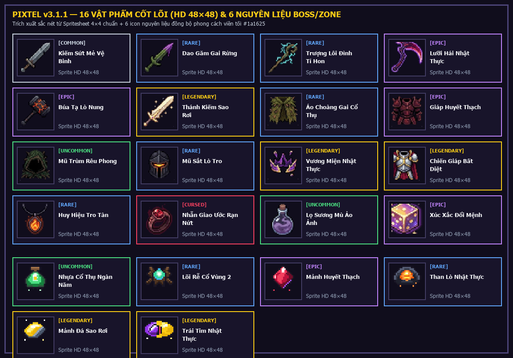
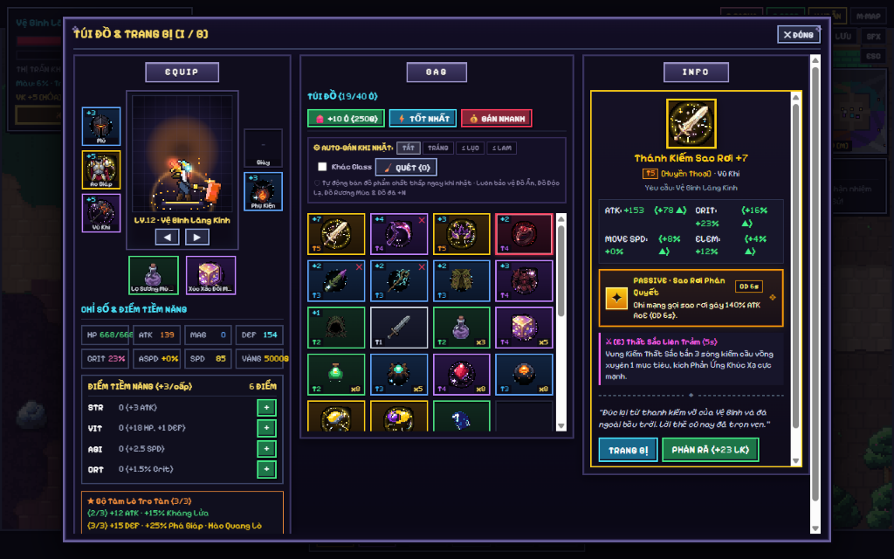
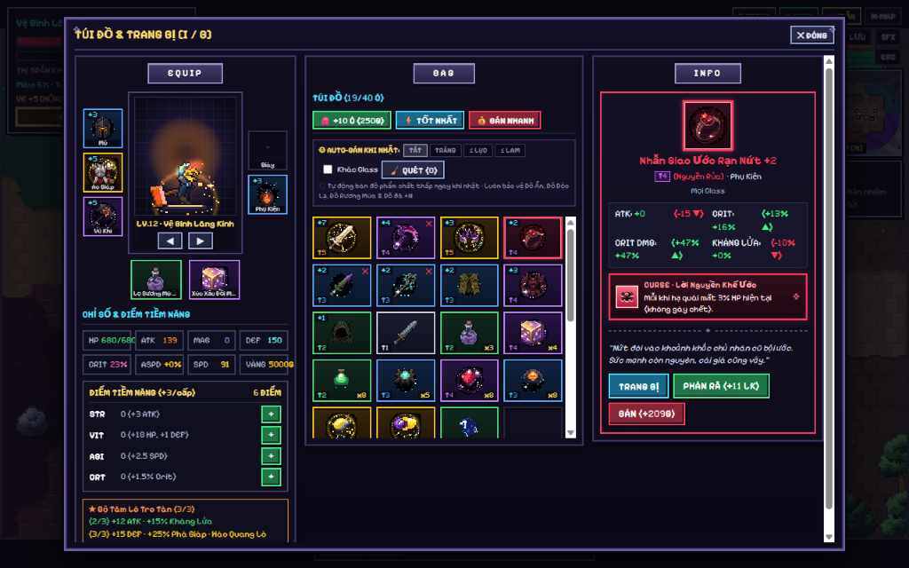
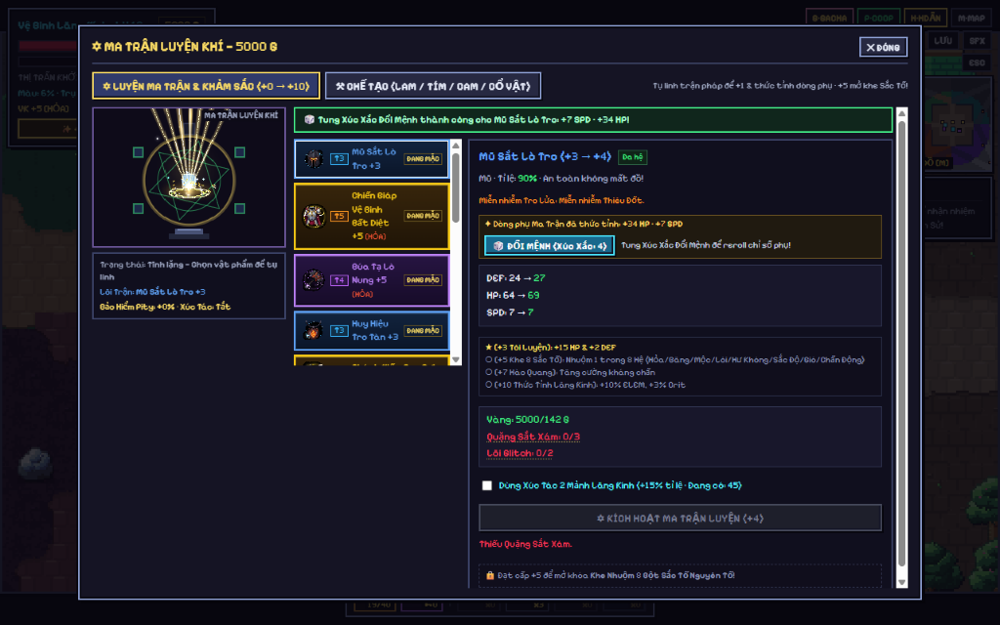
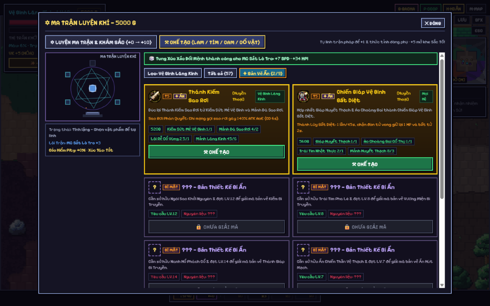
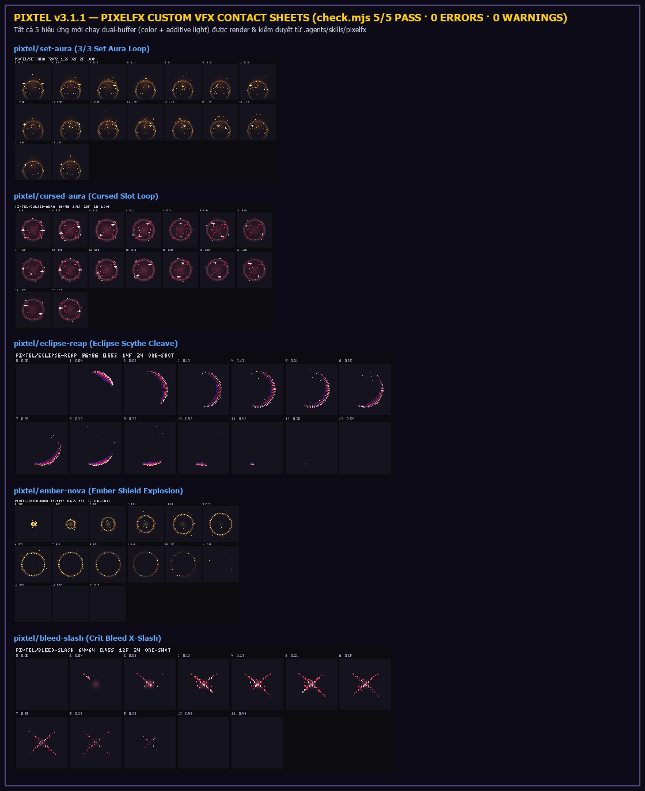

# PIXTEL v3.1.1 — Trùng Tu Đồ Họa HD 48×48, Dual-Buffer `pixelfx` VFX & UI 16-Bit Chuẩn Mockup

> **Tóm tắt cho Team:** Bản nâng cấp **v3.1.1** đại tu toàn bộ phần nhìn của Hệ thống 16 Vật phẩm Cốt lõi & Lò Rèn bằng cách tách trực tiếp sprite **HD 48×48** từ Spritesheet 4×4 gốc, tự viết & kiểm duyệt 5 hiệu ứng **`pixelfx` dual-buffer** mới (thông qua skill `patch-gg/pixelfx` đã cài sẵn tại `.agents/skills/pixelfx/`), và dựng lại UI Túi đồ 3 cột (`EQUIP` · `BAG` · `INFO`) sát chuẩn thiết kế 16-bit.

---

## So Sánh Trước / Sau (v3.1 -> v3.1.1)

| Hạng mục | Trước (`v3.1`) | Sau (`v3.1.1`) |
|---|---|---|
| **Sprite 16 Vật phẩm & 6 Nguyên liệu** | Icon vẽ procedural đơn giản `24×24`, thu nhỏ cứng `Math.min(24, w, h)` | Trích xuất **HD `48×48`** trực tiếp từ Spritesheet 4×4 bằng BFS tách nền indigo giữ nguyên viền `#1a1625` & hốc tối Mũ Rêu + 6 icon nguyên liệu đồng bộ (`src/assets/core16-items.png`, 22 frames) |
| **Hiệu ứng Chiến đấu & Rarity (`pixelfx`)** | Chủ yếu dùng hiệu ứng pooled cơ bản | Tạo mới 5 module `pixelfx` (`set-aura`, `cursed-aura`, `eclipse-reap`, `ember-nova`, `bleed-slash`), `check.mjs` **5/5 PASS (0 lỗi, 0 cảnh báo)**, nối thêm `arcane/star-fall`, `nature/thorns`, `holy/holy-pillar`, `ice/frost-nova` (`PAL.shadow`), `pixtel/hex-shield` (`PAL.blood`) |
| **Set Aura trên Paper-Doll** | Chấm vuông `ctx.fillRect` phẳng | **Dual-buffer `pixelfx` `set-aura`** (lớp `back` sau lưng nhân vật + lớp `front` phía trước, hỗ trợ đủ 3 chủ đề `forest` / `forge` / `eclipse`) + phòng spotlight & bệ đá 16-bit (`144×168`) |
| **Giao diện Túi đồ 3 Cột 16-Bit** | Khung viền tối phẳng, khối Passive thường | Bo góc chạm khắc `❖`, banner ruy-băng đuôi én `EQUIP / BAG / INFO`, ô trang bị/túi giật cấp ánh sáng theo độ hiếm, khung `INFO` showcase `72×72` cùng **biển hiệu vàng `✦ PASSIVE` / đỏ huyết `☠ CURSE`** |
| **Demo Showcase cho Dev** | Phải tự cày đồ mới xem được đủ 16 món & Set 3/3 | Mở nhanh qua URL **`?demo=v31&open=inventory`** hoặc **`?demo=v31&open=forge`** (không ghi đè save thật) |

---

## 1. Bảng 16 Vật Phẩm Cốt Lõi (HD 48×48) & 6 Nguyên Liệu Boss/Zone

---

## 2. Giao Diện Túi Đồ 3 Cột 16-Bit Mới (`EQUIP` · `BAG` · `INFO`)

- Cột trái **`EQUIP`**: Paper-Doll `144×168` đang mặc **Bộ Tâm Lò Tro Tàn `(3/3)`** với **Set Aura `pixelfx`** tỏa sáng trực tiếp phía sau & phía trước nhân vật, xung quanh là 5 ô trang bị + 2 ô tiêu hao nhanh `44×44`.
- Cột giữa **`BAG`**: Lưới 4×4 hiển thị trọn vẹn các vật phẩm HD 48×48 cùng hào quang động `pixelfx` theo 6 độ hiếm (`common`, `uncommon`, `rare`, `epic`, `cursed`, `legendary`).
- Cột phải **`INFO`**: Khung showcase `72×72`, so sánh chỉ số xanh `▲` / đỏ `▼`, **biển hiệu vàng `✦ PASSIVE`** (kèm CD) hoặc **biển hiệu huyết dụ `☠ CURSE`**, Set Bonus `(x/3)` và Lore nghiêng `#cbd5e1`.

### Trạng Thái Trang Bị Nguyền Rủa (`cursed` + `pixtel/cursed-aura`)

---

## 3. Lò Rèn Kael HD: Xúc Xắc Đổi Mệnh & Bản Vẽ Ẩn

- **Reroll chỉ số phụ với `cs_fate_die` (🎲 Đổi Mệnh)** kèm hiệu ứng tia sáng vàng `pixelfx` bùng nổ trên Ma Trận Luyện Khí:

- **Tab Bản Vẽ Ẩn (`✦ Bản Vẽ Ẩn`):** Hiển thị *Thánh Kiếm Sao Rơi* & *Chiến Giáp Vệ Binh Bất Diệt* cùng icon HD 48×48 và các bản vẽ bí ẩn chưa giải mã:

---

## 4. 5 Hiệu Ứng `pixelfx` Dual-Buffer Mới (`check.mjs` 5/5 PASS)

