# PIXTEL v3.2 — Bản Preview Tổng Hợp: Màn Hình Trang Chủ, 16 Cảnh Cốt Truyện, Preview Skill `[Q]` & Hoạt Ảnh Vũ Khí Mới

> **Ngày tạo:** `2026-11-26` · **Phiên bản:** `PIXTEL v3.2` (`v3.2.0` → `v3.2.5`)
> **Kiểm định:** `npm run build` (**0 lỗi TS**) · `tests/featureTests.ts` (**18/18 suites PASS**, bao gồm render toàn bộ 31 phân cảnh cốt truyện) · Kiểm duyệt trực tiếp trên Chrome (`1280×720`, **0 console/page errors**).

---

## Bảng Tóm Tắt Các Hạng Mục Đã Hoàn Thành

| # | Hạng mục | Chi tiết thay đổi chính | File trọng tâm |
|---|---|---|---|
| **1** | **Màn Hình Trang Chủ & Đặt Tên Nhân Vật** | Quy trình mới **Trang Chủ (Đặt Tên) → Chọn Class → Bắt Đầu**; nền 16-bit sống động 60FPS (núi 4 Quần Xã, Trụ Lăng Kính phát xung `pixelfx`, 4 Class đứng gác), nút `🎲 Ngẫu Nhiên`, nhớ tên qua `localStorage`, đồng bộ HUD, NPC, Cutscene, Co-op & Save `v3` | `src/ui/HomeScreen.ts`, `src/ui/pixelLogo.ts`, `src/ui/HUD.ts`, `src/ui/DialogueModal.ts` |
| **2** | **Chuẩn Hóa 4 Thẻ Class & Sân Khấu `SKILL [Q] PREVIEW`** | Gỡ bỏ các chiêu `[E]` cố định cũ khỏi Chọn Class & Cẩm Nang `[H]`; mỗi Class hiển thị chuẩn **Đánh thường (`LMB`)**, **Giữ (`Hold LMB`)**, **Skill cố định `[Q]`** (+ ghi chú `[E]` theo Vũ Khí). Khung preview `168×80` có **chính nhân vật 3D trực tiếp thi triển Skill `[Q]`** liên tục 60FPS | `src/ui/ClassSelect.ts`, `src/data/classes.ts`, `src/ui/TutorialModal.ts`, `style.css` |
| **3** | **6 Phim Cốt Truyện 16-bit & 16 Phân Cảnh Mở Đầu Sử Thi** | Động cơ phim `480×200` kết hợp hiệu ứng `pixelfx` hai bộ đệm + sprite quái/Boss HD `codixel`, chuyển động nhân vật ease-out, 8 bối cảnh pixel-art thủ công, 5 hiệu ứng thời tiết, bảng tiêu đề chương JRPG, **16 cảnh mở đầu (`01/16`)**, 4 phim chạm trán Boss, 1 phim Hồi Kết, chế độ **⏯ Tự Phát**, **◀ Cảnh Trước**, nhảy cảnh trực tiếp & Tab **🎬 Phim Cốt Truyện** trong Sổ `[J]` | `src/data/cutscenes.ts`, `src/ui/CutsceneModal.ts`, `src/ui/QuestJournalModal.ts` |
| **4** | **Sửa Hoạt Ảnh Hold Charge `Prism Knight` (Thánh Kiếm Phá Địa)** | Thay hoàn toàn tư thế đâm ngang giống Tinker bằng tư thế Paladin **giơ kiếm hai tay lên đỉnh đầu** tụ vương miện quang vàng → nhảy bổ dọc **`overhead_slam`** + chém **`melee/heavy-cleave` (`PAL.gold`/`PAL.holy`)** + **`ground-slam`** + **`holy/smite` (`PAL.gold`)** khi Just-Charge (**đã bỏ bùng nổ cầu vồng**) | `src/graphics/pixelfxHeroModels.ts`, `src/systems/combat.ts`, `src/game.ts` |
| **5** | **Nâng Cấp Tuyệt Kỹ `[Q]` `Bit Rogue` (Phân Thân Ảo Ảnh)** | Cả trong trận lẫn Preview: bùng khói `spawn/poof` + sóng âm + vòng xoay song đao khi bật `[Q]`; phân thân nối dây năng lượng xanh–hồng, để lại tàn ảnh tốc độ (`+100% ASPD`), **tự tốc biến sang phía đối diện mục tiêu khi vung đao** tung vệt chém gương xanh holographic + tia chí mạng vàng `crit-hit` | `src/systems/combat.ts`, `src/game.ts`, `src/ui/ClassSelect.ts` |
| **6** | **8 Hoạt Ảnh Đánh Riêng Theo Dòng Vũ Khí** | Thêm 8 tư thế vung vũ khí 3D: `overhead_slam`, `halberd_sweep`, `iaido_draw`, `dual_cross_slash`, `chakram_throw`, `orb_levitate`, `staff_whirl`, `recoil_barrage` — nối vào đòn đánh thường vũ khí đặc biệt và chiêu `[E]` riêng | `src/graphics/pixelfxHeroModels.ts`, `src/systems/combat.ts` |
| **7** | **Sửa Lỗi Hình Nhân Giả Trên `The Eraser` & Đứng Cảnh 08** | Tắt `stockActor` mặc định (`drawActor: false`) ở `scifi/glitch` & `spawn/disintegrate` để không chèn hình nhân lên Boss/quái; chỉnh `The Eraser` quay chính diện xòe đều 2 cánh; sửa `palette: undefined` ở `pixtel/prism-beam` Cảnh 08 thành `PAL.bone` + kiểm thử tự động toàn bộ 31/31 phân cảnh | `src/vfx/pixelfx/fx/scifi/glitch.js`, `src/vfx/pixelfx/fx/spawn/disintegrate.js`, `src/data/cutscenes.ts`, `tests/featureTests.ts` |

---

## 1. Màn Hình Trang Chủ & Đặt Tên Nhân Vật (`Bước 1/2`)

Mở game vào thẳng màn hình Trang Chủ `#screen-home` với bối cảnh 16-bit Aethel-16 chuyển động thời gian thực (bầu trời sao, dãy núi 4 Quần Xã, Đại Lăng Kính phát xung cầu vồng, 4 Class đứng gác hai bên). Người chơi đặt tên nhân vật (hỗ trợ tiếng Việt, có nút **🎲 Ngẫu Nhiên**) rồi mới chuyển sang bước Chọn Class, hoặc bấm **🎬 Xem Phim Cốt Truyện Mở Đầu** ngay tại đây.

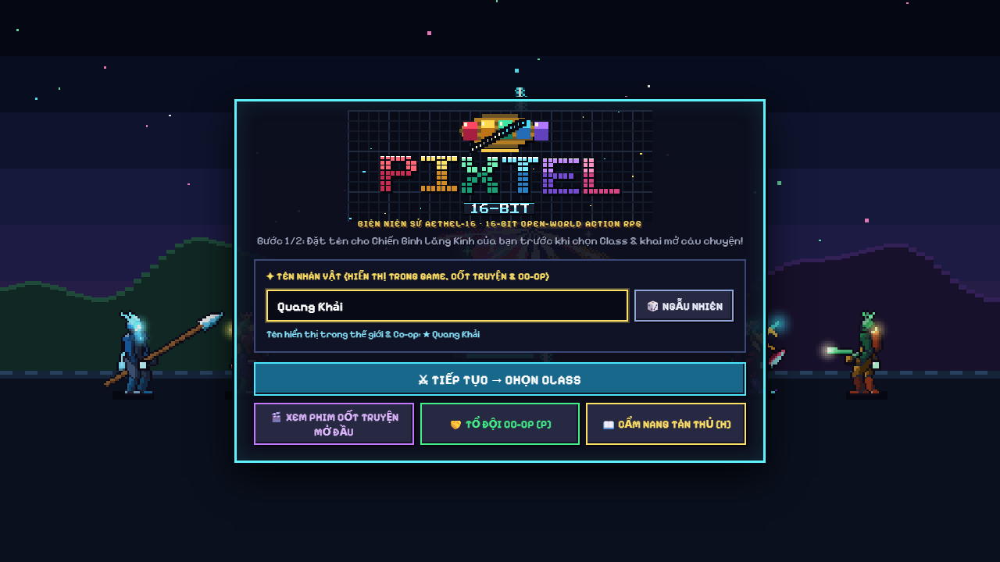

---

## 2. Màn Chọn Class (`Bước 2/2`) & Sân Khấu Nhân Vật Thi Triển Skill Cố Định `[Q]`

Toàn bộ màn Chọn Class hiển thị vừa khít khung `1280×720` không cần cuộn, hiển thị tên nhân vật vừa đặt (`✨ CHIẾN BINH: Quang Khải`), nút **← Đổi Tên / Trang Chủ**, và chỉ liệt kê đúng 3 kỹ năng cố định của mỗi Class (**Đánh thường `LMB`**, **Giữ `Hold LMB`**, **Skill cố định `[Q]`**) kèm dòng chú thích `[E]` đổi chiêu theo Vũ Khí.

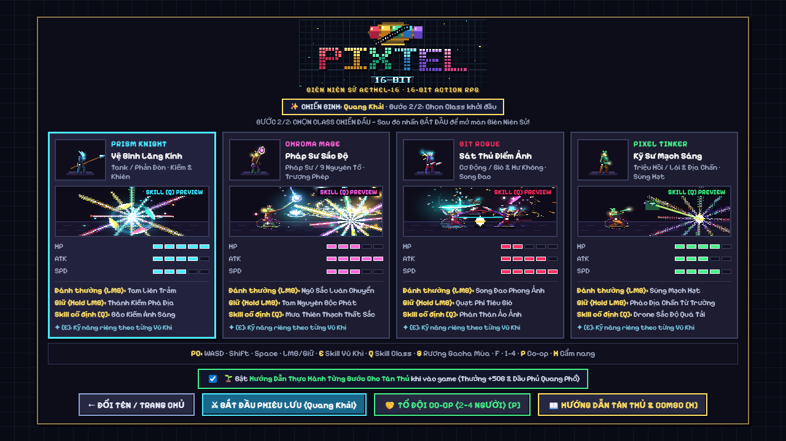

### Cận cảnh 4 sân khấu `SKILL [Q] PREVIEW` (nhân vật 3D trực tiếp thực hiện)

- **Prism Knight:** Xoay **Bão Kiếm Ánh Sáng (`[Q]`)** giữa lốc `pixtel/prism-storm`.
- **Chroma Mage:** Lơ lửng giơ trượng triệu hồi **Mưa Thiên Thạch Thất Sắc (`[Q]`)**.
- **Bit Rogue:** Bản thể + **Phân Thân Ảo Ảnh (`[Q]`)** + tàn ảnh thứ 3 tốc biến chém đồng bộ hai bên mục tiêu cùng tia `CRIT!` vàng.
- **Pixel Tinker:** Giương pháo điều khiển **Drone Sắc Độ Quá Tải (`[Q]`)** bay trên vai xả tia laser Lôi–Sắc Độ.

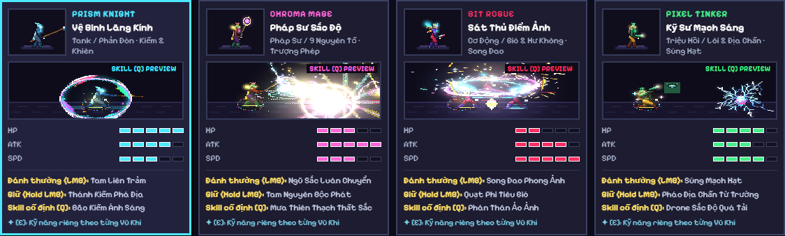

### Cận cảnh thẻ `Bit Rogue` sau khi làm lại hiệu ứng `Phân Thân Ảo Ảnh [Q]`

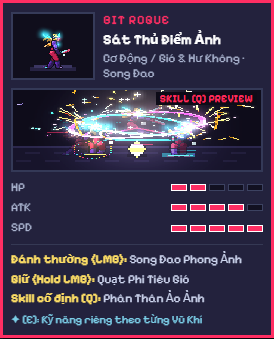

---

## 3. Đoạn Mở Đầu 16 Phân Cảnh Sử Thi & Rạp Chiếu Cốt Truyện `[J]`

Đoạn mở đầu (`scene_intro`) được mở rộng từ 4 lên **16 phân cảnh hoàn chỉnh** có bảng tiêu đề JRPG, 8 bối cảnh pixel-art thủ công, 5 loại thời tiết, thanh tiến độ `01/16`, 16 chấm nhảy cảnh trực tiếp, nút **◀ Cảnh Trước** và **⏯ Tự Phát**.

### Cảnh 01/16 — Kỷ Nguyên Chín Trụ Sắc Màu (Tiêu đề `AETHEL-16`)

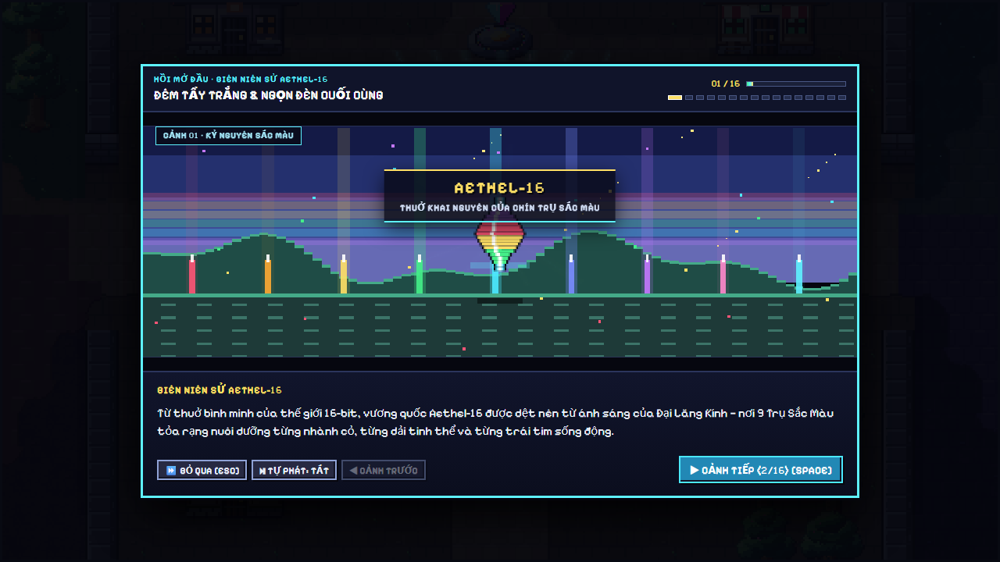

### Cảnh 06/16 — Vết Xé Không Gian & `The Eraser` Giáng Lâm (đã gỡ hình nhân giả, xòe đều 2 cánh chính diện)

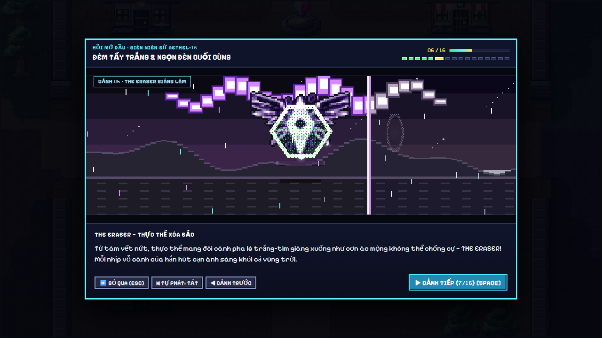

### Cảnh 08/16 — Làn Sóng Tẩy Trắng Quét Qua Thị Trấn (đã sửa lỗi đứng cảnh `prism-beam`)

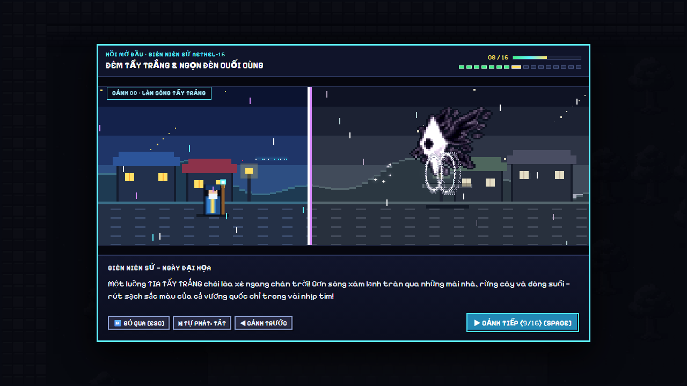

### Cảnh 11/16 — Tứ Đại Chiến Binh Tiền Bối Hợp Kích Quyết Tử

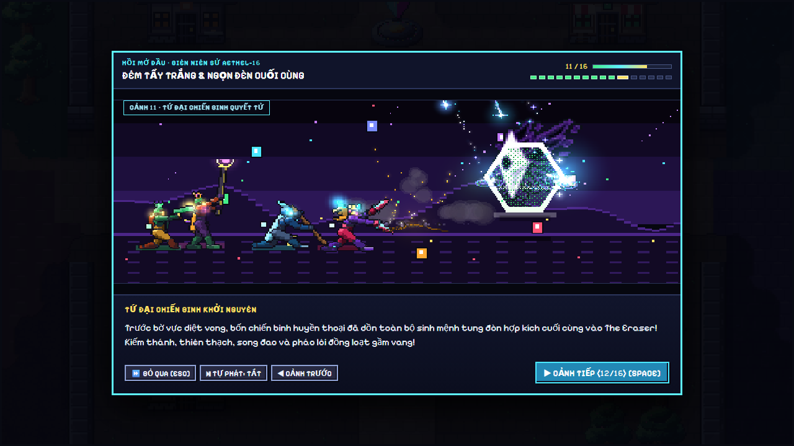

### Cảnh 16/16 — Bình Minh 4 Quần Xã & Khởi Hành Mang Tên Người Chơi

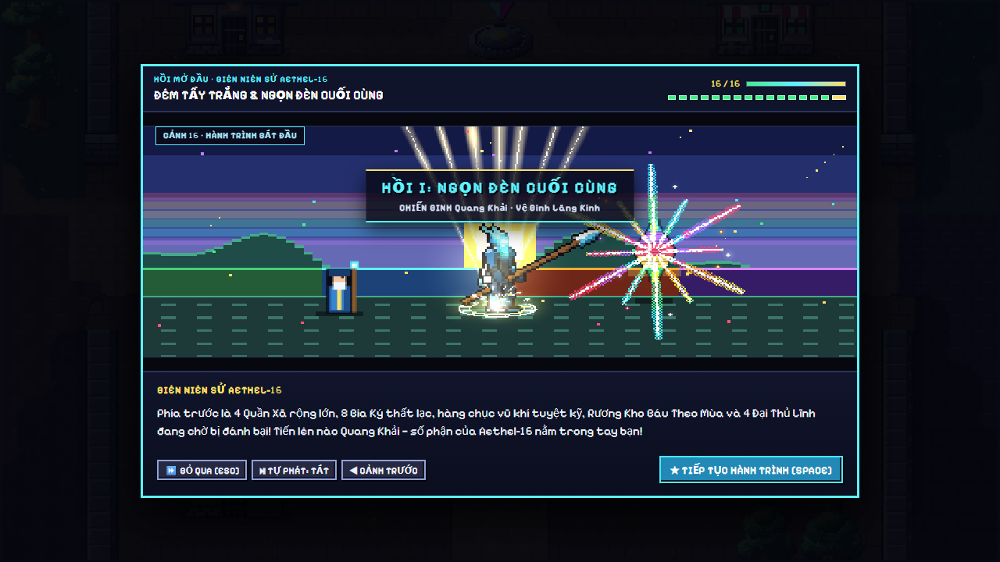

### Tab `🎬 PHIM CỐT TRUYỆN` Trong Sổ Nhiệm Vụ `[J]` (Xem Lại Cả 6 Phim Bất Kỳ Lúc Nào)

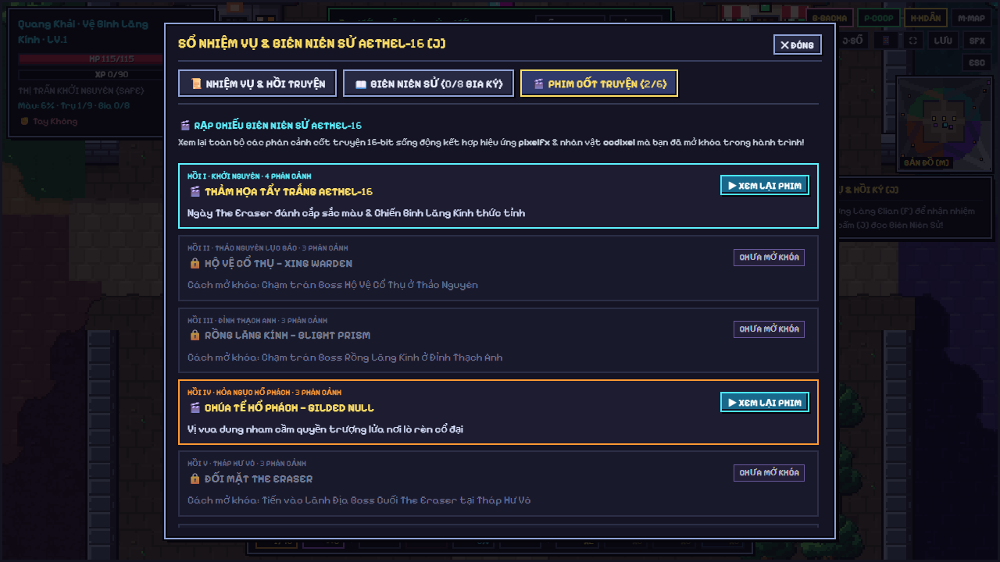

---

## 4. Kiểm Chứng Thực Chiến In-Game: `Thánh Kiếm Phá Địa` & `Phân Thân Ảo Ảnh [Q]`

### `Prism Knight` — `Thánh Kiếm Phá Địa` (Giữ LMB Just-Charge)
Tư thế bổ kiếm dọc `overhead_slam` + vệt chém vàng `melee/heavy-cleave` + sóng chấn địa `ground-slam` + cột thánh quang vàng `holy/smite` (**đã bỏ hoàn toàn hiệu ứng bùng nổ cầu vồng**, tách biệt 100% với tia ngang của `Pixel Tinker`). Đồng thời HUD góc trên trái hiển thị tên riêng `Quang Khải · Vệ Binh Lăng Kính · LV.1` và `30 G` gọn 1 dòng.

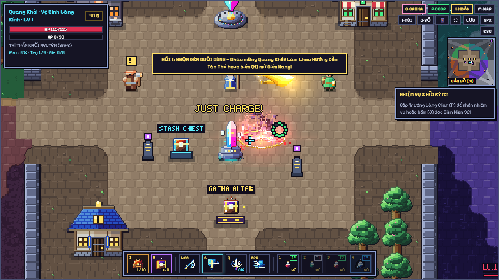

### `Bit Rogue` — `Phân Thân Ảo Ảnh [Q]` & Đòn Chém Gương Đồng Bộ
Bùng khói tách thân, vòng sóng âm, dây liên kết năng lượng xanh–hồng, tàn ảnh tốc độ và **vệt chém gương xanh holographic** đánh úp từ phía bên kia mục tiêu mỗi nhịp đánh thường.

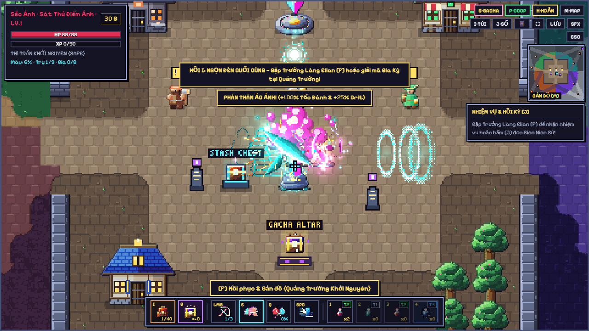
