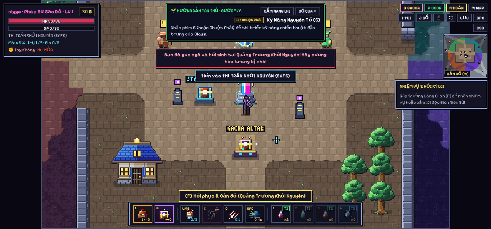
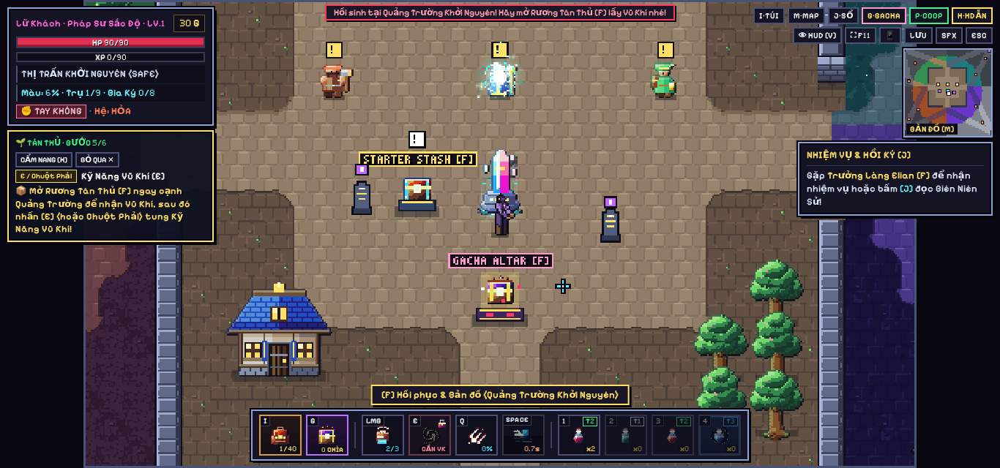
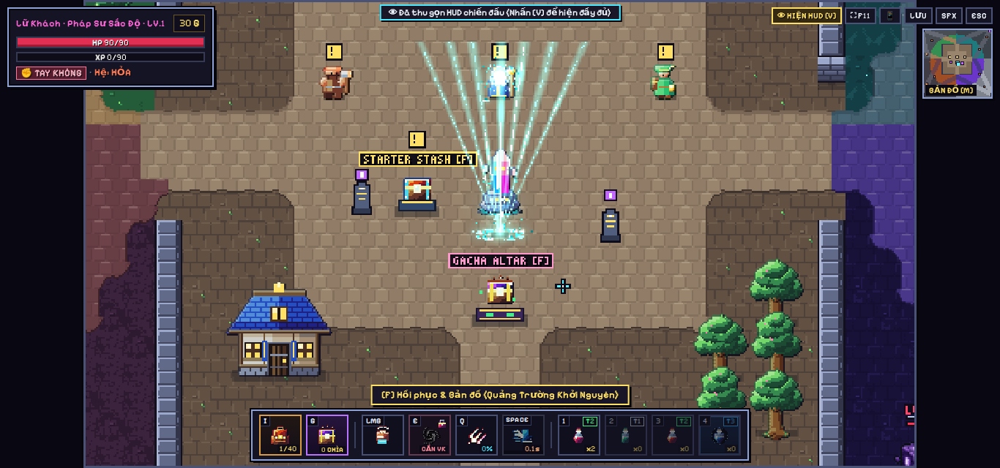

# PIXTEL v3.2.6 — Đại Tu Bố Cục HUD `0 px²` Chồng Chéo, Độ Tương Phản 16-Bit, Toàn Màn Hình `[F11]` / Thu Gọn HUD `[V]`, Bộ Lọc Tên Sạch & Luồng Tân Thủ FTUE

> **Quy trình thực hiện:** Multi-Agent Teamwork giữa đội **QA Playtester (`qa_playtester`)** trải nghiệm trực tiếp sản phẩm trên Chromium ở khung nhìn laptop thực tế (`1366×640`, `1280×680`, `1280×720`) và đội **Senior UI/UX Dev (`ui_ux_dev`)** sửa lỗi + kiểm chứng 2 vòng tới khi đạt **`100% ZERO-OVERLAP PASS`** và **`19/19` Feature Suites PASS**.

---

## 1. So Sánh Trực Quan Trước & Sau Khi Đại Tu (`1366×640` — Khung Trình Duyệt Laptop Có Bookmark & Taskbar)

### A. Trước Khi Sửa (Tái Hiện Chính Xác Ảnh Thực Tế Của Người Chơi)

### B. Sau Khi Sửa — Bố Cục Tách Lớp `0 px²` Chồng Chéo & Chỉ Dẫn Rương Tân Thủ

### C. Chế Độ Thu Gọn HUD Chiến Đấu (`[V]` / Nút `👁 HUD [V]`)

---

## 2. Tổng Hợp 6 Hạng Mục Đã Khắc Phục Triệt Để

| Hạng mục | Nguyên nhân gốc QA phát hiện | Giải pháp kỹ thuật đã áp dụng | Kết quả đo đạc QA Vòng 2 |
|---|---|---|---|
| **1. Chồng chéo trục dọc giữa màn hình** | `#hud-tutorial-banner` che 90% NPC Elian; `onPlayerDefeated()` quên cập nhật `currentBiome` làm bắn chồng 2 toast đè lên `STASH CHEST` (`2,279 px²`). | Chuyển `#hud-tutorial-banner` sang cột trái `.hud-left-stack`; neo `#toast-stack` mảnh sát mép trên (tối đa `2` toast, tự gộp trùng, `2.5s`); đồng bộ `currentBiome` khi hồi sinh/dịch chuyển. | **`0 px²`** đè lên Elian, Nhân vật, `STARTER STASH [F]` và `GACHA ALTAR [F]`. |
| **2. Cỡ chữ nhỏ & tương phản thấp** | `.hud-meta-row` `12px weight 400` không bóng chữ; `Bia 0/8` nhìn nhầm thành `Địa 0/8`; chữ `Tay Không` chìm. | Nâng lên `13px weight 600–700` có nền tối mờ & bóng pixel `1px`; đổi thành **`Bia Ký 0/8`**; đóng khung cảnh báo đỏ **`✊ TAY KHÔNG`**; vẽ biển hiệu thế giới có viền sáng + bổ sung glyph `[` `]` cho `pixelfx`. | Tương phản tăng lên **`14.5:1 – 15.9:1`**, đọc lướt rõ ngay lập tức. |
| **3. Thiếu Fullscreen & Thu gọn HUD** | Nút `⛶` nhỏ không ghi phím tắt; chưa có chế độ ẩn bảng phụ khi đánh nhau. | Đổi thành **`⛶ F11`** (bắt phím `F11` + đồng bộ `fullscreenchange`); thêm **`👁 HUD [V]`** (`KeyV`) ẩn gọn bảng phụ khi giao tranh. | Bật/tắt mượt mà cả bằng chuột lẫn phím tắt `F11` / `V`. |
| **4. Lỗi thanh phím tắt đáy (`LMB...`, `SPO`, đè icon)** | `.key-cap` trong suốt đè lên 3 pixel khớp tay nắm đấm tạo ảo giác `LMB...`; `SPC` 10px nhìn thành `SPO`; `🗝0` nhòe; `[E]` khóa bị mờ toàn ô. | Mở rộng ô lên `58×56px` (icon `32×32px`), `.key-cap` nền đặc `#0b0a16`; đổi `SPC` → **`SPACE`**, `🗝0` → **`0 CHÌA`**; ô `[E]` khi tay không hiện rõ ổ khóa đỏ + chữ **`CẦN VK`**. | Xóa sạch 100% lỗi `LMB...`, `SPO` và đè icon. |
| **5. Tên nhân vật nhạy cảm (`nigge`)** | `HomeScreen` / `CoopModal` / `SaveSystem` chưa có bộ lọc từ xấu cho dữ liệu nhập mới & `localStorage` cũ. | Tạo `src/utils/playerName.ts` (`DEFAULT_HERO_NAME = "Lữ Khách"`, lọc từ nhạy cảm Anh/Việt & leetspeak), tự động dọn sạch `localStorage` và file Save cũ ngay khi tải trang. | Tự đổi `"nigge"` cũ thành **`"Lữ Khách"`**, chặn nhập từ xấu mới kèm cảnh báo lịch sự. |
| **6. Cụm nút góc phải dày & Kẹt FTUE Bước 5/6 `[E]`** | 11 nút rớt thành 3 hàng lẻ; tân thủ tay không không có vũ khí trong `STASH CHEST` nên không thể bấm `[E]` qua Bước 5/6. | Gom `.hud-toolbar` thành **2 hàng chuẩn** (6 nút Thao tác chính + 6 nút Hiển thị/Hệ thống); đặt sẵn **Vũ Khí Khởi Đầu đúng Class** vào `STARTER STASH [F]` kèm nút **`⚡ LẤY & TRANG BỊ NGAY`** và hướng dẫn động trên Banner. | Toolbar phẳng 2 hàng (`50px`); tân thủ hoàn tất trọn vẹn 6/6 bước FTUE mượt mà. |
