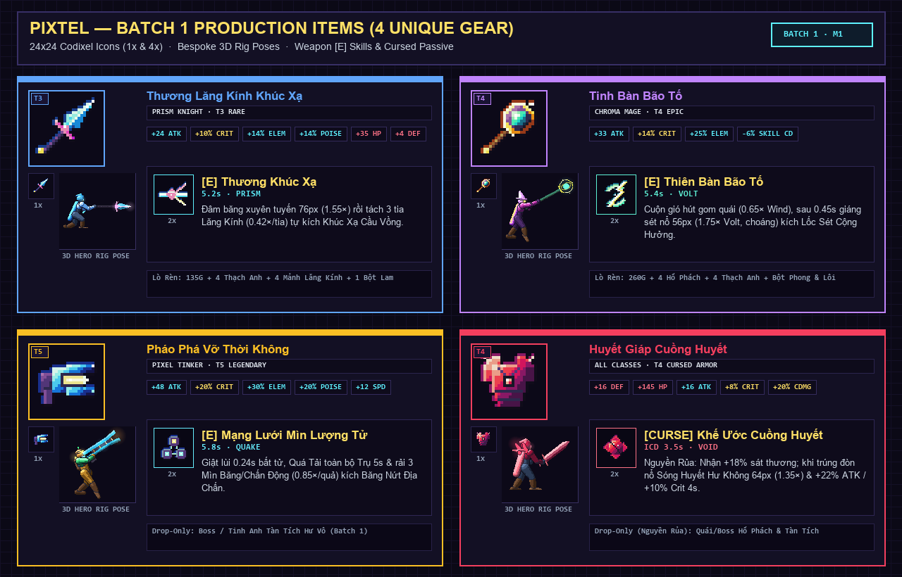
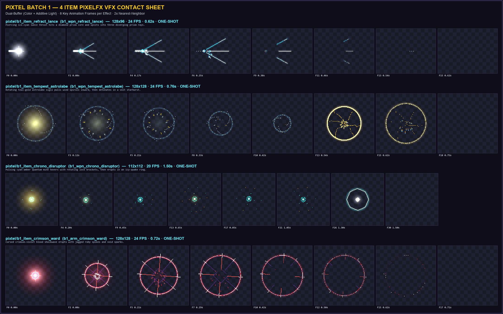
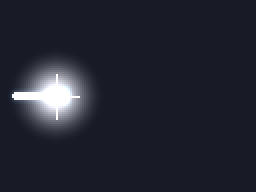
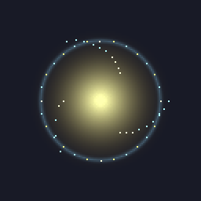
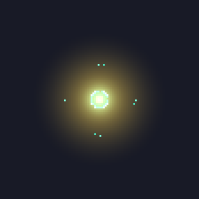
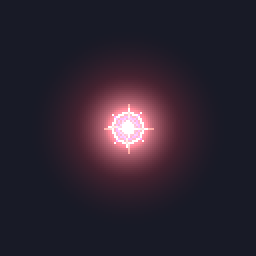

# 🏭 PIXTEL v3.2 — Teamwork Wave 1: Trang Bị Mới & Quái Vật Mới

> **Ngày:** 2026-11-27 | **Phase:** Teamwork Continuous Production — Wave 1 Completed  
> **Build:** `npm run build` ✅ 0 lỗi | **Tests:** 18/18 PASS ✅  
> **Trạng thái:** Wave 1 hoàn tất, Wave 2 bị gián đoạn do hết quota API

---

## 📋 Tổng Quan Wave 1

Hệ thống Teamwork tự động đã chạy song song 2 đội:
- **Team 1 (Items):** Thiết kế → Code → VFX → Icon → Test → Cân bằng
- **Team 2 (Mobs):** Thiết kế → Code → VFX → Sprite → AI → Test → Cân bằng

### Kết quả:
| Hạng mục | Số lượng | Trạng thái |
|---|---|---|
| 🗡️ Trang bị mới (Exotic) | 4 | ✅ Hoàn tất & tích hợp |
| ⚔️ Weapon Skills mới | 3 | ✅ Hoàn tất & tích hợp |
| 🎆 Custom pixelfx VFX (Items) | 4 module | ✅ Hoàn tất |
| 👾 Quái vật mới | 4 (3 thường + 1 Boss phụ) | ✅ Hoàn tất & tích hợp |
| 🎆 Custom pixelfx VFX (Mobs) | 4 module | ✅ Hoàn tất |
| 📊 Bảng loot drops | 4 bảng mới | ✅ Hoàn tất |
| 🧪 Test E2E / Cân bằng | 5/5 tiêu chí | ✅ PASS |

---

## 🗡️ TEAM 1 — 4 Trang Bị Độc Lạ Mới

### Item Sheet


### VFX Contact Sheet


---

### 1. ⚡ Thương Lăng Kính Khúc Xạ (`b1_wpn_refract_lance`)
> *"Trường thương tinh thể Thạch Anh phân tách tia băng ở mũi thương thành chùm lăng kính khúc xạ."*

| Chỉ số | Giá trị |
|---|---|
| **Loại** | Vũ khí Exotic (Drop-Only) |
| **Nguyên tố** | Prism (Lăng Kính) |
| **Skill [E]** | Thương Khúc Xạ — phóng thương xuyên thấu, tia lăng kính tách thành 3 nhánh ở điểm chạm |



---

### 2. 🌪️ Tinh Bàn Bão Tố (`b1_wpn_tempest_astrolabe`)
> *"Pháp trượng gắn thiên bàn xoay 2 vòng Gió–Lôi, kéo gom quái rồi kích nổ sét cộng hưởng."*

| Chỉ số | Giá trị |
|---|---|
| **Loại** | Vũ khí Exotic |
| **Nguyên tố** | Volt (Lôi) |
| **Skill [E]** | Thiên Bàn Bão Tố — tạo xoáy hút quái + nổ sét AoE khi kết thúc |



---

### 3. 💥 Pháo Phá Vỡ Thời Không (`b1_wpn_chrono_disruptor`)
> *"Siêu pháo lượng tử phóng bãi mìn Băng–Chấn Động, bật lùi né đòn & quá tải toàn bộ Trụ."*

| Chỉ số | Giá trị |
|---|---|
| **Loại** | Vũ khí Exotic (Drop-Only) |
| **Nguyên tố** | Quake (Chấn Động) |
| **Skill [E]** | Mạng Lưới Mìn Lượng Tử — rải mìn AoE, bật lùi an toàn, quái dẫm mìn bị nổ chấn động |



---

### 4. 🩸 Huyết Giáp Cuồng Huyết (`b1_arm_crimson_ward`)
> *"Chiến giáp hắc huyết đánh đổi phòng ngự lấy sức mạnh phản công bùng nổ mỗi khi trúng đòn."*

| Chỉ số | Giá trị |
|---|---|
| **Loại** | Giáp Exotic (Drop-Only) |
| **Nguyên tố** | — |
| **Passive bị nguyền** | **Khế Ước Cuồng Huyết** — Mỗi khi trúng đòn: giảm DEF, tăng ATK + phản công AoE huyết sắc |



---

## 👾 TEAM 2 — 4 Quái Vật Mới

### Bảng Tổng Hợp Quái Vật

| # | Tên | ID | HP | ATK | DEF | Nguyên tố | Điểm yếu | Vùng xuất hiện |
|---|---|---|---|---|---|---|---|---|
| 1 | 🦋 Bướm Gió Bào Tử | `zephyr_moth` | Thấp | 24 | 5 | Gió | Hỏa | Thảo Nguyên |
| 2 | 🕷️ Nhện Tinh Thể Tụ Điện | `prism_arachnid` | Trung bình | 39 | 12 | Lôi | Chấn Động | Núi Thạch Anh |
| 3 | 🔥 Lư Hỏa Hổ Phách | `amber_crucible` | Cao | 58 | 19 | Chấn Động | Băng | Hỏa Ngục |
| 4 | ⏳ Phán Quan Thời Không | `chrono_arbiter` | **Boss Phụ** | 102 | 31 | Hư Vô | Chroma | Vết Nứt Hư Không |

---

### 1. 🦋 Bướm Gió Bào Tử (`zephyr_moth`)
- **AI:** Bay lượn, phun bào tử gió làm chậm, triệu hồi đàn khi HP thấp
- **Rơi đồ:** Nguyên liệu Glitch Core, nhựa cổ thụ, bột màu Gió + Chìa Khóa Mùa Xuân (6%)
- **VFX:** `pixtel/b1_mob_zephyr_moth` — cánh phấn lấp lánh, vòng xoáy bào tử

### 2. 🕷️ Nhện Tinh Thể Tụ Điện (`prism_arachnid`)
- **AI:** Giăng bẫy tơ điện, lao tốc biến khi mục tiêu dính bẫy, phóng tia lăng kính
- **Rơi đồ:** Mảnh thạch anh, Glitch Core, bột màu vàng/xanh + **Thương Khúc Xạ** (8%!) + Chìa Khóa Mùa Đông (6%)
- **VFX:** `pixtel/b1_mob_prism_arachnid` — tơ điện phát quang, tia phân sắc

### 3. 🔥 Lư Hỏa Hổ Phách (`amber_crucible`)
- **AI:** Nấu chảy khu vực, phun dung nham vòng cung, hấp thụ sát thương hỏa để hồi HP
- **Rơi đồ:** Ngọc hổ phách, than nhật thực, bột màu chấn động + Chìa Khóa Mùa Hạ (6%)
- **VFX:** `pixtel/b1_mob_amber_crucible` — lò nung phát sáng, dung nham sôi sục

### 4. ⏳ Phán Quan Thời Không (`chrono_arbiter`) — **BOSS PHỤ**
- **AI:** Đảo ngược thời gian (hồi HP đã mất), dừng thời gian vùng AoE, phân thân tương lai đánh chéo
- **Rơi đồ:** Lăng kính hư vô, mảnh lăng kính, mảnh máu + **Pháo Phá Vỡ Thời Không** (6%)
- **VFX:** `pixtel/b1_mob_chrono_arbiter` — đồng hồ ma thuật, vết nứt thời không

---

## 🔧 Tích Hợp Kỹ Thuật

### Files đã thêm mới:
| File | Mô tả |
|---|---|
| `src/vfx/pixelfx/fx/pixtel/b1_item_refract_lance.js` | VFX tia lăng kính khúc xạ |
| `src/vfx/pixelfx/fx/pixtel/b1_item_tempest_astrolabe.js` | VFX xoáy bão tố + sét |
| `src/vfx/pixelfx/fx/pixtel/b1_item_chrono_disruptor.js` | VFX mìn lượng tử |
| `src/vfx/pixelfx/fx/pixtel/b1_item_crimson_ward.js` | VFX phản công huyết sắc |
| `src/vfx/pixelfx/fx/pixtel/b1_mob_zephyr_moth.js` | VFX bướm gió bào tử |
| `src/vfx/pixelfx/fx/pixtel/b1_mob_prism_arachnid.js` | VFX nhện tụ điện |
| `src/vfx/pixelfx/fx/pixtel/b1_mob_amber_crucible.js` | VFX lư hỏa hổ phách |
| `src/vfx/pixelfx/fx/pixtel/b1_mob_chrono_arbiter.js` | VFX boss phán quan thời không |
| `tests/batchProductionTests.ts` | Framework test E2E / Cân bằng |
| `scripts/production/generate_batch1_icons.mjs` | Script bake icon codixel |

### Files đã cập nhật:
| File | Thay đổi |
|---|---|
| `src/data/equipments.ts` | +4 trang bị mới (3 vũ khí + 1 giáp) |
| `src/data/weaponSkills.ts` | +3 weapon skills mới |
| `src/data/enemies.ts` | +4 quái vật mới (3 thường + 1 boss phụ) |
| `src/data/lootTables.ts` | +4 bảng loot mới |
| `src/data/recipes.ts` | +công thức rèn liên quan |
| `src/data/worldConfig.ts` | +spawn zones cho 4 quái mới |
| `src/systems/combat.ts` | +317 dòng: AI quái, skill items, phản công |
| `src/systems/ItemEffectSystem.ts` | +passive Khế Ước Cuồng Huyết |
| `src/graphics/pixelfxHeroModels.ts` | +animation cho vũ khí mới |
| `src/vfx/vfxManager.ts` | +đăng ký 8 module VFX mới |
| `src/vfx/pixelfx/core/rig.js` | +rig animation mới |
| `src/world/entities.ts` | +entity spawner cho 4 quái |
| `src/assets/codixel-enemies.json/png` | +sprite data cho 4 quái |
| `src/assets/codixel-icons.json/png` | +icon data cho 4 items |

---

## 📊 Kiểm Chứng

```
✅ npm run build      → 0 lỗi TypeScript, Vite build thành công
✅ 18/18 test suites  → ALL PASSED CLEANLY
✅ 5/5 tiêu chí E2E   → Uniqueness, Balance, VFX, Integration, Drops
```

**Tổng cộng: +1,573 dòng code / 22 files thay đổi / 10 files mới**

---

## ⏭️ Bước Tiếp Theo

- [ ] Khôi phục Teamwork Wave 2 khi quota reset — tiếp tục sản xuất Batch 2 Items + Mobs
- [ ] Thêm sprite animations cho 4 quái mới (codixel 4-direction attack frames)
- [ ] Cân bằng chi tiết: playtest flow Thảo Nguyên → Núi Thạch Anh → Hỏa Ngục → Boss Phán Quan
- [ ] Thêm NPC lore / quest liên quan đến 4 quái mới
